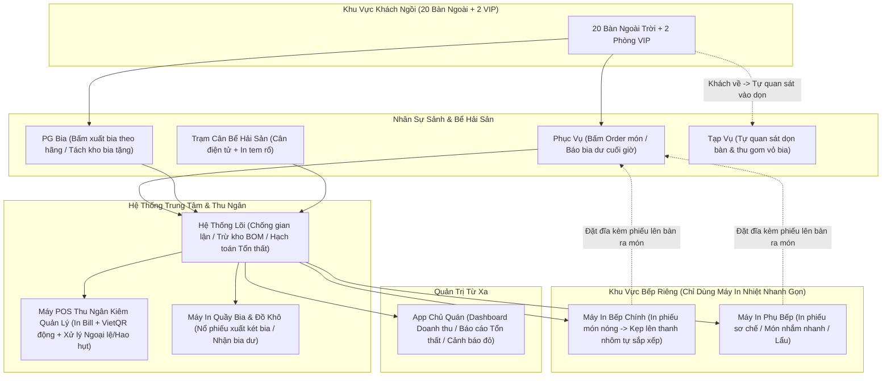
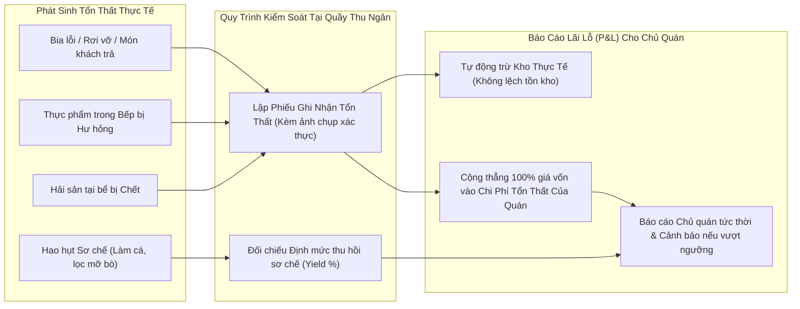
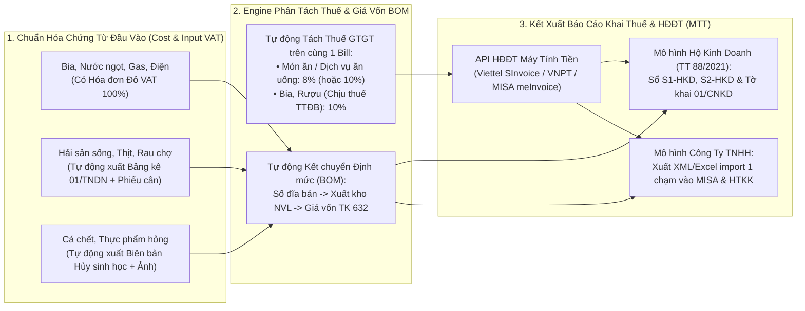
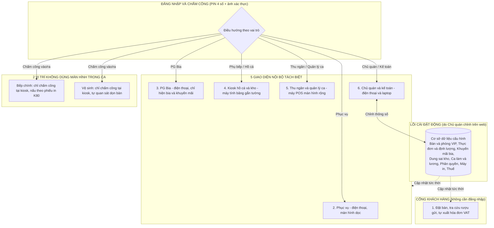

# Phân Tích Nghiệp Vụ Toàn Diện (A–Z): Hệ Thống Vận Hành Tinh Gọn, Chống Gian Lận & Kiểm Soát Tổn Thất Cho Quán Nhậu

Tài liệu này phân tích chi tiết bức tranh vận hành của quán nhậu khi chuyển đổi từ **100% truyền thống** sang **hệ thống số hóa thực chiến (Practical Automation)** — giữ lại sự nhanh nhạy, linh hoạt của quán nhậu Việt Nam (Bếp nhìn phiếu in làm nhanh, Phục vụ tự quan sát bưng bê), nhưng khóa chặt mọi kẽ hở thất thoát tiền bạc, bia bọt, hải sản và nguyên vật liệu.

- **Quy mô không gian:** 20 bàn ngoài trời + 2 Phòng VIP + Khu Bếp riêng + Khu Thu ngân riêng + Khu Bể hải sản tươi sống.
- **Nhân sự (7 Roles):** Chủ quán, Thu ngân kiêm Quản lý, Phục vụ, PG các hãng bia, Bếp chính, Phụ bếp (kiêm sơ chế/hải sản), Vệ sinh/Tạp vụ.

---

## 1. Kiến Trúc Vận Hành Tinh Gọn (Thực Chiến Cho Quán Nhậu)

Theo đúng thực tế quán nhậu 20 bàn + 2 VIP: **Bếp và Phục vụ không cần thao tác màn hình rườm rà**. Hệ thống tập trung kiểm soát tại **3 chốt chặn đầu - cuối**: **(1) Lúc gọi món/cân hải sản -> (2) Lúc in phiếu xuất Bếp/Kho bia -> (3) Lúc tính tiền/kiểm kho/xử lý hao hụt**.



---

## 2. Nghiệp Vụ Tinh Gọn Theo Từng Vai Trò (7 Roles)

### 2.1. Chủ Quán (Owner) — "Nắm trọn số liệu & Tổn thất từ xa"
1. **Dashboard Thời Gian Thực trên Điện thoại:**
   - Biết ngay hiện tại đang có bao nhiêu bàn ngồi, doanh thu tạm tính trên sân là bao nhiêu, doanh thu đã thu về két là bao nhiêu.
2. **Kiểm soát Chi phí Tổn thất & Hao hụt (Loss & Wastage Tracking):**
   - Xem báo cáo riêng về: *Giá trị cá/hải sản chết trong ngày, nguyên liệu bếp hủy hỏng, món khách trả lại, hóa đơn tiếp khách/miễn phí*.
3. **Hệ thống Cảnh báo Đỏ & Phê duyệt OTP:**
   - Nhận tin nhắn cảnh báo ngay khi tại quán có thao tác: *Xóa/Hủy món sau khi đã in phiếu bếp, Sửa bill sau khi đã in tạm tính, Báo hủy hải sản chết, Ghi nợ khách quen*.

---

### 2.2. Thu Ngân Kiêm Quản Lý (Cashier & Shift Manager) — "Chốt chặn trung tâm"
Với mô hình tinh gọn cho Bếp và Phục vụ, **Thu ngân kiêm Quản lý** là người giữ kỷ luật vận hành của toàn bộ hệ thống:
1. **Đầu ca:** Mở ca, nhập tiền lẻ, điểm danh nhân sự & PG bia, xác nhận số lượng hải sản bơi đầu ca và tồn kho tủ bia.
2. **Trong ca:**
   - Điều phối ghép bàn, chuyển bàn (VD: trời mưa khách chạy từ sân vào mái hiên/VIP), tách bill.
   - Khi Bếp báo hết nguyên liệu món nào -> Thu ngân bấm `Khóa món (Hết hàng)` trên POS để Phục vụ không bấm gọi món đó nữa.
   - Trực tiếp kiểm tra và lập phiếu trên POS cho các trường hợp tổn thất & ngoại lệ: **Hải sản chết, Thực phẩm hỏng, Món khách trả lại, Đồ rơi vỡ**.
3. **Thanh toán:**
   - Nhận thông tin số bia/khăn lạnh hoàn trả -> Kiểm nhận hàng trả về quầy -> In phiếu tạm tính có gắn **Mã VietQR Động** (tiền vào tài khoản Chủ quán thì máy tự động gạch nợ).
4. **Cuối ca (Kết ca mù - Blind Close):**
   - Đếm tiền mặt thực tế trong két nhập vào máy (không nhìn thấy số hệ thống trước) -> Đối chiếu tồn bia và nguyên liệu chính cuối ca.

---

### 2.3. Bếp Chính & Phụ Bếp — "Chỉ dùng Máy In Nhiệt nhanh gọn, không cần bấm màn hình"
Đúng với đặc thù bếp quán nhậu Việt Nam (tay dính dầu mỡ, lửa lớn, cần tốc độ cao), khu vực Bếp **hoàn toàn không dùng màn hình cảm ứng**, chỉ dùng **Máy in nhiệt công nghiệp (có còi báo + đèn chớp)**:

1. **Tự động tách luồng in thông minh:**
   - Khi Phục vụ bấm gửi order cho `Bàn 08`, hệ thống tự động tách đơn in ra đúng vị trí trong 1 giây:
     - **Máy in Bếp Chính (Bếp nóng):** Chỉ in các món xào, nướng, chiên, nấu lẩu.
     - **Máy in Phụ Bếp (Khu sơ chế/Món nhanh):** Chỉ in các món ra ngay (đậu phộng, xoài cóc, khô mực, trái cây, rau/mì thêm).
2. **Cách in phiếu giúp Bếp Chính tự sắp xếp cực nhanh:**
   - Máy in hỗ trợ cấu hình **In cắt rời từng món (hoặc từng nhóm chế biến)** với cỡ chữ cực to:
     - Dòng 1: **`BÀN 08 - [MÓN MỚI]`** *(Hoặc `[PHÒNG VIP 1 - ƯU TIÊN]`)*
     - Dòng 2: **`1 x ẾCH XÀO SẢ ỚT (Ít cay)`**
     - Dòng 3: Giờ gọi: `19:12` - Phục vụ: `Nam`
   - Bếp chính chỉ việc rút tờ giấy in kẹp lên **Thanh kẹp bill nhôm (Ticket Rail)** trước mặt. Nhìn lên thanh kẹp thấy 3 bàn cùng gọi *"Ếch xào sả ớt"*, Bếp chính tự động gom lại xào 1 chảo lớn chia 3 đĩa theo đúng kinh nghiệm nghề bếp mà không cần chạm vào bất kỳ thiết bị điện tử nào.
3. **Ra món kèm phiếu (Chống nhầm bàn & Chống làm khống):**
   - Làm xong món nào, Bếp rút tờ phiếu trên thanh nhôm **kẹp thẳng vào mép đĩa** đặt lên bàn ra món và bấm chuông cơ *"Ting!"*.
   - **Nguyên tắc vàng chống gian lận tại Bếp:** *"Không có phiếu in từ máy = Tuyệt đối không bật bếp nấu"*. Mọi đĩa thức ăn đặt lên bàn ra món bắt buộc phải có tờ phiếu in nhiệt đi kèm.

---

### 2.4. Phục Vụ & Vệ Sinh (Tạp Vụ) — "Order trực tiếp trên điện thoại, tự quan sát thực tế"
Với quy mô 20 bàn ngoài trời và 2 phòng VIP, tầm nhìn rất thoáng nên hệ thống tối ưu tốc độ tối đa:
1. **Phục vụ (Bắt buộc Order trên Điện thoại ngay tại bàn):**
   - Mỗi Phục vụ sử dụng **App Order trên điện thoại** để thao tác ngay tại bàn khách đang ngồi (không ghi giấy tay, không phải chạy đi chạy lại):
     1. **Bấm gọi món / thêm món ngay tại bàn:** Khách vừa đọc món xong, Phục vụ bấm chọn bàn -> chọn món -> bấm `Gửi` ngay tại chỗ (mất 3–5 giây). Ngay khi Phục vụ còn đang đứng ở bàn khách, máy in trong Bếp và Quầy bia đã nổ phiếu để làm món ngay lập tức.
     2. **Đếm số bia/khăn lạnh còn nguyên** trên bàn lúc khách gọi tính tiền, nhập số trả lại ngay trên điện thoại và mang bia dư về quầy Thu ngân.
   - **Việc bưng món:** Phục vụ tự quan sát bàn ra món của Bếp (hoặc nghe tiếng chuông cơ của Bếp), nhìn tờ phiếu kẹp trên đĩa là biết ngay của bàn nào để bưng ra, vừa đi vừa xé góc phiếu (đánh dấu đã lên món).
2. **Vệ sinh / Tạp vụ:**
   - **Không cần dùng điện thoại hay màn hình.** Tạp vụ tự quan sát thấy khách đứng dậy rời bàn là lập tức vào thu dọn bát đĩa, gom vỏ bia về khu tập kết và lau sạch bàn để đón khách mới.
   - *(Điểm kiểm soát nhỏ)*: Khi gom két vỏ bia từ bàn vừa về, nếu thấy trong két còn sót lon/chai bia chưa khui mà Phục vụ quên đếm hoặc khách bỏ quên đồ, Tạp vụ mang thẳng lại quầy Thu ngân.

---

### 2.5. PG Các Hãng Bia — "Quản lý sản lượng & Bia khuyến mãi"
1. PG dùng App trên điện thoại (hoặc mã PIN cá nhân) để bấm xuất bia (theo két/thùng hoặc theo lon) cho bàn mình chăm sóc -> Máy in tại **Quầy Bia/Thu Ngân** nổ phiếu -> Quầy bia giao két bia cho PG.
2. Cuối buổi, số chai chưa khui mang trả lại quầy được Thu ngân xác nhận trừ trực tiếp trên máy -> Hệ thống tự động chốt **số lon thực uống** để tính tiền khách và tính doanh số cho từng PG.
3. Bia tặng của hãng (mua 5 tặng 1) được bấm xuất từ mã `Bia Khuyến Mãi Hãng (0đ)` riêng biệt, không bao giờ lẫn với bia kho quán.

---

### 2.6. Trạm Cân Bể Hải Sản (Phụ Bếp Phụ Trách)
1. Khách ra bể chọn hải sản -> Phụ bếp vớt lên đặt vào Cân điện tử kết nối phần mềm.
2. Bấm chọn `Số Bàn` + `Loại Hải Sản` + `Cách Chế Biến`.
3. **Số kg tự động truyền vào phần mềm** -> Tự động cộng tiền vào Bill của bàn tại Thu ngân, đồng thời in ngay **1 phiếu nhiệt chống nước tại bể** kẹp vào rổ hải sản mang vào Bếp chính.

---

## 3. Nghiệp Vụ Quản Lý Chi Phí Tổn Thất & Hao Hụt (Cá Chết, Thực Phẩm Hỏng, Đổ Vỡ)

Nguyên tắc xuyên suốt của hệ thống là **Đơn giản - Minh bạch**: Mọi hao hụt như **cá chết, thực phẩm hư hỏng, đồ đổ vỡ** đều được ghi nhận thẳng vào **Chi phí Tổn thất của quán** (trừ khỏi tồn kho thực tế và tính vào chi phí giá vốn tổn thất trong báo cáo Lãi/Lỗ), đi kèm cơ chế xác thực để nhân viên không thể "báo khống cá chết/đồ hỏng" nhằm lấy cắp hàng sống.



### 3.1. Xử Lý Hải Sản Chết Tại Bể (Tính Thẳng Vào Chi Phí Tổn Thất)
Không cần các bước trung gian phức tạp, khi phát hiện cá, tôm hùm, cua, ghẹ... chết trong bể, quy trình chỉ gói gọn như sau:

| Tình Huống Tại Bể | Cách Hệ Thống Hạch Toán Tự Động | Chốt Chặn Chống Gian Lận ("Báo cá chết giả để lấy cá sống") |
| :--- | :--- | :--- |
| **1. Cá / Hải sản chết trong bể** | • Phụ bếp vớt ra báo cho Thu ngân/Quản lý.<br>• Quản lý cân xác nhận và bấm **`Ghi Nhận Hải Sản Chết`** trên máy POS (Chọn loại cá + Số con + Số kg).<br>• Hệ thống tự động:<br>  1. **Trừ ngay số con và số kg** đó khỏi tồn kho Bể Hải Sản.<br>  2. **Tính thẳng 100% giá nhập vốn** của con cá đó vào mục **`Chi Phí Tổn Thất Của Quán`** trong ngày. | • **Xác thực bằng hình ảnh / Camera:** Khi lập phiếu báo cá chết, Quản lý chụp 1 tấm ảnh con cá đã cắt đuôi/rạch bụng trên đĩa cân gửi đính kèm vào phiếu trên hệ thống -> Chủ quán nhìn điện thoại thấy ngay hôm nay chết 1 con cá mú 1.4kg (trị giá vốn 350.000đ) và nhân viên không thể lấy cá sống báo khống là cá chết. |
| **2. Hao hụt trọng lượng tự nhiên trong bể (Cá gầy đi, cua ráo nước)** | • Ví dụ: Nhập bể 10 con cá mú (tổng 15.0 kg). Khi bán hết đúng 10 con nhưng tổng số cân bán ra trên bill đạt **14.4 kg** (hụt 0.6 kg nước/trọng lượng tự nhiên).<br>• Hệ thống đối chiếu thấy **Đủ 10 con** và độ lệch cân nằm trong ngưỡng tự nhiên (< 5%) -> Tự động tất toán phần chênh lệch trọng lượng vào hao hụt tự nhiên của lô hàng. | • **Kiểm soát kép (Số Con + Số Kg):** Nhờ đếm cả **Số Con**, nhân viên không thể bắt trộm 1 con cá rồi đổ thừa cho "hao hụt trọng lượng nước" vì máy sẽ báo **Thiếu 1 con** ngay lập tức. |

---

### 3.2. Xử Lý Thực Phẩm Hư Hỏng & Hao Hụt Sơ Chế Trong Bếp
1. **Hao hụt sơ chế định mức (Trim & Prep Loss):**
   - Ví dụ: Mua 10 kg thịt bò tươi hoặc 10 kg mực lá, sau khi Phụ bếp lạng gân/mỡ, làm sạch túi mực thì còn lại **8.0 kg thịt sạch** (Định mức thu hồi chuẩn = 80%), chia được **40 túi định lượng (200g/túi = 1 đĩa)**.
   - Trên hệ thống: Khi nhập 10 kg bò nguyên liệu, hệ thống yêu cầu Phụ bếp sau khi sơ chế xong phải báo số túi thành phẩm chia được (VD: 39 hoặc 40 túi).
   - Nếu hôm nào nhập 10 kg bò mà Phụ bếp chỉ chia ra được 33 túi (hụt mất 7 túi = 1.4 kg thịt bò), hệ thống lập tức cảnh báo đỏ ngay từ lúc giao ca sáng mà không cần đợi đến cuối tháng!
2. **Thực phẩm hư hỏng do bảo quản (Rau úa, đồ rã đông bị chua, quá hạn):**
   - Mỗi lần bỏ đi bất kỳ nguyên liệu nào, Bếp phải mang ra báo Quản lý lập **`Phiếu Xuất Hủy Nguyên Liệu`** (chọn lý do: *Hỏng do tủ mát / Để quá hạn / Hàng nhà cung cấp giao kém chất lượng*).
   - Cuối tuần, Chủ quán nhìn vào biểu đồ **Tỷ lệ Hủy hàng (Waste Cost)** sẽ biết ngay Bếp có đang đặt hàng dư thừa hay bảo quản cẩu thả hay không.

---

### 3.3. Xử Lý Đổ Vỡ, Bia Xì Gas & Sự Cố Dụng Cụ
- **Chai/Lon bia bị xì gas, móp méo hoặc rơi vỡ:**
  - Nhân viên giữ lại **nắp chai còn nguyên (hoặc lon chưa bật khoen)** đưa về cho Thu ngân.
  - Thu ngân nhập vào **`Kho Bia Lỗi Chờ Đổi Hãng`** (nếu lỗi nhà sản xuất để đại lý bia bù 1-đổi-1 đợt giao hàng tới) hoặc **`Chi phí Đổ vỡ`** (nếu do nhân viên/khách làm vỡ). Nhờ vậy kho bia cuối ca luôn khớp 100%.

---

## 4. Kịch Bản Xử Lý 8 Trường Hợp Ngoại Lệ Thường Gặp Tại Quán Nhậu

Quán nhậu là môi trường phát sinh rất nhiều tình huống ngoài kịch bản chuẩn. Hệ thống được thiết kế sẵn nút xử lý nhanh tại máy Thu ngân cho 8 trường hợp ngoại lệ sau:

### Ngoại lệ 1: Khách trả lại món / Khiếu nại món ăn (Món mặn, nguội, ra trễ, hoặc Phục vụ bấm nhầm)
* **Nguy cơ gian lận:** Nếu cho phép xóa món tự do khi khách trả lại, Thu ngân sẽ lợi dụng để xóa các món khách đã ăn và thu tiền mặt rồi bảo "Khách trả lại món".
* **Cách xử lý chuẩn trên hệ thống:**
  1. Đĩa thức ăn trả lại phải được bưng về đặt tại quầy Thu ngân (nơi có camera) trước khi chuyển vào bếp.
  2. Thu ngân bấm **`Xử lý Món Trả Lại`** trên POS với **3 lựa chọn hạch toán rõ ràng**:
     - **Nhánh A — Bếp làm lại đĩa mới (Đổi món):** Không cộng thêm tiền trên bill khách, nhưng in phiếu `[LÀM LẠI - ĐỔI MÓN]` xuống Bếp và **trừ kho thêm 1 phần nguyên liệu** (ghi vào *Chi phí lỗi chế biến*).
     - **Nhánh B — Khách hủy không ăn nữa (Món đã nấu chín):** Xóa tiền món đó trên bill của khách để khách vui vẻ, nhưng **Kho vẫn trừ nguyên liệu** và cộng giá vốn đĩa đó vào mục **`Chi phí Tổn thất Món Hủy`**, đồng thời gửi thông báo cho Chủ quán.
     - **Nhánh C — Phục vụ bấm nhầm nhưng món còn nguyên vẹn, chuyển ngay cho bàn khác vừa gọi:** Chuyển món đó từ `Bàn 05` sang `Bàn 12` chỉ bằng 1 chạm -> Quán không mất đồng chi phí nào.

### Ngoại lệ 2: Khách chọn hải sản tại bể, đã đập đầu sơ chế nhưng khách đổi ý đòi hủy/đổi món
* **Cách xử lý:**
  - Ngay lúc cân tại bể, phiếu in nhiệt luôn có 2 liên (1 liên kẹp rổ vào bếp, 1 liên đặt tại bàn khách hoặc đọc to số cân trước mặt khách).
  - Nếu cá đã đập đầu làm sạch mà khách nằng nặc đòi đổi sang món khác: Quản lý có thể linh hoạt chiều khách (miễn/giảm trên bill bàn đó), nhưng trên máy POS phải chuyển con cá đó sang trạng thái **`Hàng Sơ Chế Sẵn Cần Đẩy Bán Gấp`** (hiện nổi bật trên màn hình Thu ngân/Phục vụ để tư vấn ưu tiên cho các bàn tiếp theo gọi món cá tương tự trong vòng 1–2 tiếng).

### Ngoại lệ 3: Đang nhậu ngoài sân thì trời đổ mưa rào (Chạy bàn hàng loạt)
* **Tình huống:** 15 bàn ngoài trời cùng lúc bưng đồ ăn, xách két bia chạy vào mái hiên hoặc ghép bàn.
* **Cách xử lý:**
  - Thu ngân dùng tính năng **`Chuyển / Ghép bàn 1 chạm`** trên sơ đồ bàn để gom bill.
  - Nếu lúc chạy mưa các két bia dưới gầm bàn bị trộn lẫn giữa bàn A và bàn B, khi kết thúc chỉ cần nhập tổng vỏ hoàn trả hoặc chuyển lượng bia dư giữa các bàn có ghi chú `[Chuyển bàn mưa]` để tổng lượng bia xuất/nhập toàn sảnh vẫn khớp tuyệt đối.

### Ngoại lệ 4: Khách nhậu say bỏ về quên trả tiền (Walk-out) hoặc Khách thiếu tiền/Quên mang ví
* **Cách xử lý:**
  - Thu ngân **không được để treo bàn qua đêm** và cũng **không được tự bỏ tiền túi hoặc xóa bill**.
  - Bấm nút **`Đóng bàn: Khách nợ / Thất thoát (Walk-out)`**:
    - Kho bia và nguyên liệu bếp **vẫn được trừ đúng 100%** theo số khách đã ăn uống.
    - Két tiền mặt của Thu ngân **không bị lệch**.
    - Khoản tiền chưa thu được chuyển thẳng vào danh mục **`Công nợ / Thất thoát chờ xử lý`** trên điện thoại Chủ quán (kèm mốc giờ để Chủ quán xem lại camera hoặc liên hệ khách nếu là người quen).

### Ngoại lệ 5: Khách quen / Công ty "Ký sổ" (Ăn trước, cuối tháng thanh toán)
* **Cách xử lý:**
  - Khi thanh toán, Thu ngân chọn phương thức **`Ghi Nợ Khách Quen (Công nợ)`** -> Chọn tên khách trong danh bạ (VD: *Anh Tuấn - Công ty XD*) -> Khách ký vào tờ bill in ra (hoặc Chủ quán bấm duyệt trên điện thoại).
  - Hệ thống tự động cộng dồn vào **Sổ Công Nợ Phải Thu** của khách đó, đến hạn tự động nhắc Chủ quán thu hồi nợ và gạch nợ khi khách chuyển khoản.

### Ngoại lệ 6: Chủ quán tiếp khách / Tặng mồi cho bàn khách quen
* **Nguy cơ:** Nhân viên rất hay mượn cớ "Em tặng trái cây cho khách quen của anh Chủ" để lấy đồ trong bếp ra ăn hoặc tiếp bạn bè của nhân viên.
* **Cách xử lý:**
  - Mọi món tặng (đĩa trái cây, đĩa đậu phộng, hay cả bàn tiệc của Chủ quán) **bắt buộc phải bấm vào máy POS để in phiếu bếp như bình thường**.
  - Khi tính tiền món đó (hoặc cả bàn đó), Thu ngân chọn **`Chủ Quán Mời / Tặng Khách (Giá 0đ)`** -> Hệ thống gửi thông báo ngay về máy Chủ quán: *"Bàn 09 vừa được áp dụng Tặng món: 1 Đĩa Trái Cây (Do Quản lý Hùng thực hiện)"*. Kho vẫn trừ đúng 1 đĩa trái cây và hạch toán vào *Chi phí Tiếp khách*.

### Ngoại lệ 7: Khách mang rượu ngoài vào quán (Rượu ngâm / Rượu ngoại)
* **Nguy cơ:** Nhân viên lén mang rượu/bia từ ngoài vào bán chui cho khách trong phòng VIP để ăn tiền riêng.
* **Cách xử lý:**
  - Ngay khi khách mang bình rượu quê hoặc chai rượu ngoại vào bàn, Phục vụ/Thu ngân phải bấm mặt hàng **`[Khách Mang Rượu Ngoài]`** vào bàn đó (có thể thu phí phục vụ/đá/ly hoặc để 0đ tùy quy định của Chủ quán).
  - Nhờ dòng ghi chú này trên bill, khi Chủ quán nhìn camera thấy bàn VIP có chai rượu trên bàn nhưng mở POS ra thấy có dòng `[Khách Mang Rượu Ngoài]` thì yên tâm 100% không phải nhân viên bán hàng lậu.

### Ngoại lệ 8: Mất điện hoặc đứt mạng Internet vào đúng giờ cao điểm (19h – 21h)
* **Cách xử lý:**
  - Hệ thống chạy theo cơ chế **Mạng nội bộ (Local Offline-First)**: Chỉ cần 1 bộ lưu điện nhỏ (UPS ~ 1 triệu đồng) nuôi cục phát Wi-Fi, máy POS Thu ngân và máy in Bếp, thì dù cả khu phố mất điện hay đứt cáp quang, Phục vụ vẫn bấm máy gọi món và máy in Bếp vẫn nổ bill bình thường trong suốt 3–4 tiếng.

---

## 5. Quy Trình Nhập Kho, Kiểm Kho Mù (Blind Count) & Đối Soát Đa Chiều (4 Tầng)

Nếu chỉ kiểm soát lúc bán hàng tại bàn thì nhân viên vẫn có thể gian lận ở **khâu nhận hàng đầu ngày** hoặc **khâu đếm kho cuối ngày**. Hệ thống khóa chặt vòng đời hàng hóa bằng 3 cơ chế nối tiếp nhau (được mô hình hóa chi tiết tại [07_Nhanh_Nhap_Kho_Va_Kiem_Kho_Mu.drawio](file:///C:/quan_nhau/bpmn_drawio/07_Nhanh_Nhap_Kho_Va_Kiem_Kho_Mu.drawio) và [08_Nhanh_Doi_Soat_Da_Chieu_Kho_Va_Tien.drawio](file:///C:/quan_nhau/bpmn_drawio/08_Nhanh_Doi_Soat_Da_Chieu_Kho_Va_Tien.drawio)):

### 5.1. Nhập Kho Đầu Ngày — Nguyên Tắc "Đồng Kiểm 2 Người & Chia Túi Định Lượng"
* **Hải sản tươi sống nhập bể:**
  - Khi Nhà cung cấp (NCC) giao hàng buổi sáng, Phụ bếp phải **loại bỏ ngay các con ngộp/yếu trả lại NCC tại chỗ**.
  - Đặt rổ hải sản đã ráo nước lên **Cân điện tử IoT** (đã trừ bì rổ) để máy tự đọc **`[Số Kg thực nhận]`** kết hợp nhập **`[Số Con thực đếm]`**.
  - **Đồng kiểm 2 người:** Thu ngân kiêm Quản lý + Phụ bếp cùng xác nhận trên POS và chụp ảnh phiếu cân (chống tuyệt đối việc nhân viên thông đồng với mối giao hàng ký khống phiếu 10kg trong khi chỉ giao 8kg).
* **Thực phẩm Bếp (Thịt bò, Gà, Mực, Tôm đông, Rau lẩu):**
  - Bếp chính kiểm tra độ tươi, cân thực nhận và tiến hành **Chia túi định lượng chuẩn (`Portioning`) ngay sau khi sơ chế** (ví dụ: 2kg thịt bò thăn chia sẵn thành đúng **10 túi $\times$ 200g/túi** cất vào tủ mát).
  - Nhờ chia túi ngay từ đầu, việc kiểm kho bếp cuối ngày cực kỳ nhanh: chỉ cần **đếm số túi còn lại** thay vì phải lôi từng tảng thịt ra cân lại!
* **Bia, Nước ngọt, Vỏ Két Cược & Bia Khuyến Mãi Đại Lý:**
  - Khi đại lý giao bia, Quản lý nhập tách bạch 2 kho trên POS: **`Kho Bia Bán Chính Thức`** và **`Quỹ Bia Khuyến Mãi Hãng Tặng`** (nếu không nhập riêng số két khuyến mãi lúc nhận hàng, nhân viên sẽ lấy bia tặng bán thu tiền mặt bỏ túi riêng).
  - Đồng thời thực hiện **Trả vỏ két rỗng cược** và **Đổi 1-1 các chai/lon bị xì ga** đã giữ lại từ ca trước.

### 5.2. Kiểm Kho Mù (`Blind Inventory Audit`) — Chống "Chép Số Khống"
* **Điểm yếu truyền thống:** Nếu phiếu kiểm kho in ra có sẵn cột *"Tồn trên máy: 18 con cá mú, 145 lon Tiger"*, nhân viên sẽ lười không đếm mà điền luôn `18` và `145`, hoặc nếu đếm thấy còn `150` lon thì lấy luôn `5` lon bỏ túi vì biết máy chỉ ghi `145`!
* **Cơ chế Kiểm Kho Mù trên hệ thống:**
  - Vào cuối ca (hoặc đầu ca / kiểm đột xuất), App/POS phát lệnh **Kiểm Kho Mù**: màn hình chỉ liệt kê tên mặt hàng, **ẩn 100% số lượng tồn lý thuyết trên máy**.
  - **Phụ bếp** đếm số con hải sản đang bơi trong bể; **Bếp chính** đếm số túi định lượng/nguyên liệu chính trong tủ; **Thu ngân** đếm số két bia nguyên + bia lẻ + vỏ két + nắp/vỏ lon KM đã thu hồi + đếm tiền mặt trong két (**Blind Cash Count**).
  - Ngay khi bấm **"Gửi Số Liệu Kiểm Mù"**, hệ thống khóa cứng số vừa nhập (không cho sửa lại) rồi mới bật bảng so sánh với số lý thuyết!

### 5.3. Đối Soát Đa Chiều Tự Động (4 Tầng Đối Soát Cuối Ca)

Hệ thống tự động chạy 4 công thức đối soát độc lập và áp dụng ngưỡng dung sai riêng cho từng nhóm:

| Tầng Đối Soát | Công Thức Đối Soát Tự Động Trên Hệ Thống | Ngưỡng Dung Sai & Cách Bắt Gian Lận |
| :--- | :--- | :--- |
| **Tầng 1: Bể Hải Sản Tươi Sống (Đối soát Kép Con + Kg)** | $$\text{Tồn Lý Thuyết} = \text{Tồn Đầu} + \text{Nhập} - \text{Bán Qua Cân POS} - \text{Cá Chết (Có Ảnh)}$$<br/>So sánh đồng thời cả **Số Con** và **Số Kg** với số đếm thực tế. | - **Dung sai Số Con = 0 con:** Thiếu dù chỉ **1 con** mà không có phiếu/ảnh cá chết cắt đuôi $\rightarrow$ **Báo động Đỏ** (Mất cắp hoặc bán chui không qua POS).<br/>- **Dung sai Số Kg $\le 5\%$:** Nếu đủ số con nhưng tổng số Kg hụt $\le 5\%$ $\rightarrow$ Hợp lệ (cá nhịn ăn/mất nước tự nhiên). Nếu đủ số con mà hụt $> 5\%$ Kg $\rightarrow$ Cảnh báo **nhân viên tráo cá lớn trong bể lấy cá nhỏ**! |
| **Tầng 2: Kho Bếp Chính & Phụ Bếp (Định mức BOM & Túi định lượng)** | $$\text{Tiêu Hao Lý Thuyết} = \sum (\text{Số Dĩa Bán} \times \text{Định Mức/Dĩa}) + \text{Hủy Có Phiếu}$$<br/>Đối chiếu với số túi định lượng / số kg thực tế còn trong tủ. | - **Dung sai $\pm 3\%$:** Hợp lệ.<br/>- **Thiếu $> 3\%$:** Bếp làm rơi vãi/cháy hỏng giấu không lập phiếu hoặc lấy nguyên liệu ăn/mang về.<br/>- **Dư bất thường $> 5\%$:** Cảnh báo **Bếp ăn bớt định lượng món của khách** (VD: dĩa bò quy định 200g nhưng bếp chỉ xào 150g làm khách chê ít!). |
| **Tầng 3: Kho Bia, Quỹ KM Hãng & Vỏ Két Cược** | Đối soát 3 phương trình:<br/>1. $\text{Bia Bán Tồn Cuối} = \text{Đầu} + \text{Nhập} - \text{Bia Thực Uống} - \text{Bể/Xì}$<br/>2. $\text{Bia KM Đã Tặng} == \text{Số Vỏ Lon / Nắp Chai KM Thu Hồi}$<br/>3. $\text{Vỏ Chai Rỗng Cuối Ca} = \text{Vỏ Đầu} + \text{Bia Chai Đã Khui}$ | - **Dung sai Bia & Nắp KM = 0 lon/chai:** Lệch 1 lon cũng báo đỏ.<br/>- Nếu xuất bia KM trên máy mà thiếu vỏ/nắp KM thực tế tại quầy $\rightarrow$ PG/Thu ngân khai khống bia tặng để lấy bia bán thu tiền riêng.<br/>- Kiểm soát chặt số vỏ chai/két nhựa để không bị mất tiền cọc vỏ với đại lý. |
| **Tầng 4: Đối Soát Tài Chính 3 Chiều & Audit Log** | $$\text{Tổng Bill Đã Đóng} == (\text{Tiền Mặt Thực Đếm} - \text{Vốn Đầu} + \text{Phiếu Chi}) + \text{Tổng Webhook VietQR} + \text{Ký Sổ / Bill Mời}$$ | - **Dung sai Tiền mặt & VietQR = 0 đồng.**<br/>- Quét tự động **Audit Log Đỏ**: Liệt kê các bàn in `Phiếu kiểm đồ` $\ge 2$ lần, các bàn có sửa/hủy món sau Pre-bill, hoặc các bàn ngồi $> 3\text{ giờ}$ nhưng tổng bill thấp bất thường để Chủ quán xem lại camera. |

* **Cơ chế Xử lý khi phát hiện Lệch:**
  1. Hệ thống chỉ đích danh mặt hàng bị lệch và yêu cầu Quản lý + Bếp **Kiểm đếm lại lần 2** (tránh trường hợp gõ nhầm số lúc kiểm mù).
  2. Nếu đếm lại lần 2 vẫn thiếu thật sự: Hệ thống bắt buộc lập **`Biên Bản Giải Trình Chênh Lệch Ca`** đính kèm mốc giờ Camera và đẩy về điện thoại **Chủ quán** để Chủ quán bấm chọn 1 trong 2 phán quyết:
     - **Phán quyết 1 (Lỗi nhân viên / Mất hàng không rõ lý do):** Ghi thẳng vào `Công nợ Phải thu Nội bộ` để trừ lương/thưởng trách nhiệm ca và cân bằng lại kho thực tế.
     - **Phán quyết 2 (Lý do khách quan hợp lý):** Chủ quán duyệt OTP cho phép hạch toán vào `Chi phí Tổn thất của quán` trên P&L.

---

## 6. Thiết Kế Chi Tiết 5 Mẫu In Bill / Phiếu Nhiệt K80 (Bếp, Bể Hải Sản, Quầy Bia & Khách Hàng)

Toàn bộ máy in trong quán thống nhất sử dụng **Máy in nhiệt khổ K80 (80mm) có dao cắt tự động (Auto-cutter) kết nối mạng LAN** (chi phí giấy in chỉ ~15đ/phiếu, không bao giờ hết mực). Tuy nhiên, **cách trình bày trên tờ bill của Bếp và của Khách hoàn toàn khác nhau** để tối ưu tốc độ và chống gian lận (được mô hình hóa tại [09_Nhanh_In_Bill_Va_Bao_Cao_Thue.drawio](file:///C:/quan_nhau/bpmn_drawio/09_Nhanh_In_Bill_Va_Bao_Cao_Thue.drawio)):

### 6.1. Nguyên Tắc & Mẫu In Bill Cho Bếp Chính / Phụ Bếp ("In Cắt Rời Từng Món - Chữ Cực To")
* **Tại sao KHÔNG in cả danh sách 7 món chung vào 1 tờ giấy dài cho Bếp?**
  - Nếu in 7 món chung 1 tờ, khi Bếp nấu xong món thứ nhất muốn kẹp phiếu vào đĩa cho Phục vụ bưng ra thì không biết xé tờ giấy kiểu gì!
  - Do đó, hệ thống cấu hình chế độ **`In Tách Rời Từng Món (Single-Item Auto-Cut)`**: Khách gọi 4 món $\rightarrow$ Máy in Bếp xoẹt 4 nhát cắt ra **4 tờ phiếu ngắn độc lập**.
  - Bếp chính rút 4 tờ kẹp lên **Thanh trượt nhôm (Ticket Rail)**. Món nào xào xong, rút đúng tờ phiếu đó **kẹp vào mép đĩa** đặt lên quầy trả đồ!
* **Mẫu Phiếu In Nhiệt Bếp Nóng / Bếp Phụ (Khổ K80 - Không in giá tiền):**

```text
================================================
   [BÀN 08 - SÂN VƯỜN]          Lượt gọi: #02
   (Nếu làm lại sẽ in nền đen: [LÀM LẠI - ƯU TIÊN])
------------------------------------------------
 SL   TÊN MÓN CHẾ BIẾN (CỠ CHỮ GẤP 3)
------------------------------------------------
 01 x ẾCH XÀO SẢ ỚT
      >> GHI CHÚ: ÍT CAY, KHÔNG HÀNH LÁ
------------------------------------------------
 (Nếu là món từ Bể Hải Sản sẽ tự động in kèm dòng):
 [Tem Cân #HS-082 | Cá Mú Đỏ: 01 Con = 1.45 Kg]
------------------------------------------------
 Giờ order: 19:15:08          Phục vụ: Nam (ĐT)
 Mã phiếu: #K-261104-089      Trạm: BẾP NÓNG
================================================
         (Dao máy in tự động cắt rời)
```

---

### 6.2. Mẫu Tem Cân Bể Hải Sản (In 2 Liên Chống Nước Tại Bể)
Khi Phụ bếp vớt cá lên cân điện tử IoT, máy in tại bể tự động nhả ra **2 liên nối tiếp nhau**:
- **Liên 1 (Đưa khách xem xác nhận tại bàn/bể trước khi đập đầu cá)**
- **Liên 2 (Kẹp thẳng vào rổ cá mang vào Bếp để Bếp biết con cá này của bàn nào, chia làm mấy món)**

```text
================================================
        PHIẾU XÁC NHẬN CÂN HẢI SẢN TƯƠI SỐNG
              [BÀN 08 - SÂN VƯỜN]
------------------------------------------------
 Mã Tem Cân : #HS-082         Giờ cân: 19:14:22
 Loại Hải Sản: CÁ MÚ ĐỎ SỐNG (BỂ SỐ 1)
------------------------------------------------
 SỐ LƯỢNG CON: 01 Con
 TRỌNG LƯỢNG : 1.45 Kg  (Đã trừ bì rổ)
 ĐƠN GIÁ     : 650.000 đ/Kg
 THÀNH TIỀN  : 942.500 đ
------------------------------------------------
 YÊU CẦU CHẾ BIẾN (2 MÓN):
  1. Đầu + Xương : Nấu Lẩu Chua Cay -> [Bếp Phụ]
  2. Thân + Phi lê: Hấp Hồng Kông   -> [Bếp Nóng]
------------------------------------------------
 Phụ bếp cân: Тùng            Phục vụ: Nam
================================================
```

---

### 6.3. Mẫu Phiếu Xuất Bia Tại Quầy Bia / Thu Ngân ("Không Phiếu = Không Xuất")

```text
================================================
           PHIẾU XUẤT KHO QUẦY BIA
              [BÀN 08 - SÂN VƯỜN]
------------------------------------------------
 PHÂN LOẠI: [X] BIA BÁN TÍNH TIỀN
            [ ] BIA TẶNG KHUYẾN MÃI HÃNG (0đ)
------------------------------------------------
 XUẤT: 01 KÉT BIA TIGER NÂU (24 Chai)
 KÈM : 01 Xô Đá + 04 Khăn Lạnh
------------------------------------------------
 Người bấm xuất: PG Lan (PIN #04) | Giờ: 19:12
 Mã phiếu: #B-261104-041
================================================
```

---

### 6.4. Hai Mẫu Bill In Cho Khách Hàng (`Phiếu Kiểm Đồ Tạm Tính` & `Hóa Đơn Chính Thức`)

Khách nhậu rất nhạy cảm chuyện **cân hải sản** và **đếm vỏ bia**. Vì vậy Bill cho khách không được gộp mập mờ mà phải chia thành **3 khối rõ ràng** (Hải sản cân ký – Món ăn bếp – Bia thực uống sau khi đã trừ bia trả lại):

````carousel
```text
================================================
               QUÁN NHẬU HẢI SẢN
       Đ/c: ... - Hotline: 09xx.xxx.xxx
------------------------------------------------
          PHIẾU KIỂM ĐỒ (TẠM TÍNH)
              [BÀN 08 - SÂN VƯỜN]
       *** LẦN IN: 01 (ĐÃ KHÓA BILL) ***
       (Nếu in lại sẽ hiện: LẦN IN 02 - OTP)
 Giờ vào: 18:50   Giờ in: 21:35   Phục vụ: Nam
------------------------------------------------
 I. HẢI SẢN TƯƠI SỐNG (THEO CÂN THỰC TẾ)
 1. Cá Mú Đỏ Sống (#HS-082)
    01 Con | 1.45 Kg x 650.000     942.500
    (- Đầu nấu lẩu chua cay: 0đ)
    (- Mình hấp Hồng Kông  : 0đ)
------------------------------------------------
 II. MÓN ĂN BẾP & KHAI VỊ
 2. Ếch xào sả ớt       01 x 120.000   120.000
 3. Đậu phộng rang muối 01 x  30.000    30.000
 4. Rau + Bún thêm lẩu  01 x  35.000    35.000
------------------------------------------------
 III. BIA, NƯỚC NGỌT & KHĂN (ĐÃ TRỪ HÀNG DƯ)
 5. Bia Tiger Nâu (Chai):
    [Xuất: 24 | Trả lại: 06 | Uống: 18]
    18 Chai x 22.000                   396.000
 6. Bia Tiger KM Hãng (Đã thu 03 vỏ)
    03 Lon  x      0                         0
 7. Khăn lạnh [Xuất 4 - Trả 1 = 3]
    03 Cái  x  3.000                     9.000
================================================
 TỔNG CỘNG THANH TOÁN:            1.532.500 đ
================================================
    [ QUÉT MÃ VIETQR ĐỘNG ĐỂ THANH TOÁN ]
       +-----------------------------+
       |  [MÃ QR ĐỘNG VIETQR NAPAS]  |
       |  Số tiền: 1.532.500 VND     |
       |  ND: TT BAN08 HD26110408    |
       +-----------------------------+
  (Quý khách vui lòng kiểm tra lại số lượng
   món ăn & số bia thực uống trước khi TT)
================================================
```
<!-- slide -->
```text
================================================
               QUÁN NHẬU HẢI SẢN
       Đ/c: ... - Hotline: 09xx.xxx.xxx
------------------------------------------------
           HÓA ĐƠN THANH TOÁN CHÍNH THỨC
         Số HĐ: #HD-261104-008 | BÀN 08
         Thu ngân: Quản lý Hùng | 21:38:12
------------------------------------------------
 Tổng tiền hàng & dịch vụ :        1.532.500 đ
 Chiết khấu / Giảm giá    :                0 đ
------------------------------------------------
 TỔNG THANH TOÁN          :        1.532.500 đ
 Hình thức TT: CHUYỂN KHOẢN VIETQR (ĐÃ NHẬN)
 Mã GD Ngân hàng: FT26308991204 (21:38:09)
================================================
   [ QUÉT MÃ QR NHẬN HÓA ĐƠN ĐỎ (GTGT/VAT) ]
       +-----------------------------+
       |  [QR TRA CỨU & XUẤT HĐĐT]   |
       |  Mã tra cứu: QN08-99412     |
       +-----------------------------+
  Quý khách Công ty cần xuất Hóa đơn Điện tử
  (HĐĐT khởi tạo từ máy tính tiền) vui lòng
  quét mã QR trên và nhập Mã Số Thuế trong
  ngày. Hệ thống tự động gửi về Email/Zalo!
         XIN CẢM ƠN & HẸN GẶP LẠI!
================================================
```
````

---

## 7. Lộ Trình Hóa Đơn Điện Tử Khởi Tạo Từ Máy Tính Tiền (MTT) & Báo Cáo Khai Thuế

Ngành F&B / Quán nhậu tại Việt Nam hiện nay chịu sự giám sát rất chặt về **Hóa đơn điện tử khởi tạo từ máy tính tiền (MTT)** kết nối Tổng cục Thuế (theo Nghị định 123/2020/NĐ-CP và Nghị định 70/2025/NĐ-CP) cùng bài toán **hợp thức hóa chi phí đầu vào** (vì hải sản sống, rau tươi mua ở chợ/ngư dân thường không có hóa đơn VAT). Hệ thống giải quyết trọn vẹn từ A–Z như sau:



### 7.1. Tự Động Tách Thuế Suất GTGT Trên Cùng Một Bàn Nhậu (Món Ăn vs. Bia Rượu)
* **Vấn đề thực tế:** Trong các giai đoạn Nhà nước áp dụng chính sách giảm thuế GTGT (ví dụ giảm từ 10% xuống **8%**), **Dịch vụ ăn uống (Món ăn, Lẩu, Hải sản)** được giảm xuống **8%**, nhưng **Bia và Rượu** là mặt hàng chịu Thuế Tiêu thụ Đặc biệt nên **bắt buộc giữ nguyên thuế suất 10%**. Nếu Thu ngân gõ tay hoặc dùng phần mềm thường sẽ tính sai thuế ngay lập tức!
* **Giải pháp tự động của hệ thống:**
  - Trong danh mục hàng hóa, mỗi món đã được gắn sẵn mã nhóm thuế (`VAT_FOOD = 8%`, `VAT_ALCOHOL = 10%`).
  - Khi khách Công ty quét QR yêu cầu xuất hóa đơn đỏ (hoặc đọc Mã số thuế cho Thu ngân), hệ thống **tự động tách dòng thuế suất 8% và 10% trên cùng 1 tờ Hóa đơn điện tử** và đẩy API sang `MISA meInvoice` / `Viettel SInvoice` / `VNPT Invoice` để cấp mã Cơ quan Thuế trong 3 giây.

### 7.2. Giải Quyết Bài Toán "Chi Phí Đầu Vào Không Có Hóa Đơn Đỏ" (Hải Sản Sống, Đồ Chợ)
Để quán không bị xuất toán chi phí giá vốn khi cơ quan thuế kiểm tra, hệ thống tự động lập **3 bộ hồ sơ chi phí đầu vào** từ chính thao tác nhập kho và kiểm kho hàng ngày:
1. **Nhóm Hàng Có Hóa Đơn GTGT Đầu Vào (Bia, Nước ngọt, Rượu chính ngạch, Gas, Điện, Nước):**
   - Hệ thống đồng bộ XML hóa đơn điện tử đầu vào từ đại lý bia khớp với `Phiếu Nhập Kho Bia` ở Nhánh 7.
2. **Nhóm Hải Sản Tươi Sống, Rau Củ, Thịt Tươi Mua Trực Tiếp Từ Ngư Dân / Nông Dân / Chợ Đầu Mối (Không có hóa đơn VAT):**
   - Từ dữ liệu cân điện tử đầu ngày ở Nhánh 7, cuối tháng hệ thống tự động kết xuất ra **`Bảng Kê Thu Mua Hàng Hóa, Dịch Vụ Mua Vào Không Có Hóa Đơn (Mẫu số 01/TNDN)`** (đính kèm thông tin Họ tên, số CCCD, địa chỉ người bán, chữ ký xác nhận và lệnh chuyển khoản/phiếu chi tiền mặt). Đây là chứng từ hợp pháp 100% để đưa tiền mua hải sản/thịt/rau vào chi phí giá vốn được trừ!
3. **Hồ Sơ Định Mức Chế Biến (`BOM`) & Biên Bản Hủy Cá Chết / Thực Phẩm Hư Hỏng:**
   - Hệ thống tự động xuất **`Bảng Định Mức Nguyên Vật Liệu Chính Cho Từng Món Ăn`** và **`Biên Bản Kiểm Kê - Hủy Nguyên Vật Liệu Hư Hỏng Sinh Học`** (trích xuất từ các `Phiếu Tổn Thất + Ảnh chụp cá chết` ở Nhánh 5) để giải trình hợp lệ phần hao hụt nguyên vật liệu.

### 7.3. Đường Xuất Báo Cáo Khai Thuế Cuối Tháng / Quý (Hộ Kinh Doanh & Công Ty)
Tùy theo quán của bạn đăng ký pháp nhân là **Hộ Kinh Doanh** hay **Công Ty TNHH**, cuối tháng/quý Chủ quán (hoặc Kế toán dịch vụ) chỉ cần bấm 1 nút để tải trọn bộ hồ sơ khai thuế:
* **Trường hợp 1 — Quán đăng ký là HỘ KINH DOANH KÊ KHAI (Theo Thông tư 88/2021/TT-BTC):**
  - Tự động xuất chuẩn 7 sổ kế toán Hộ kinh doanh (file Excel in ra ký hoặc nộp điện tử):
    - **`Sổ chi tiết doanh thu bán hàng hóa, dịch vụ (Mẫu S1-HKD)`**: Tách sẵn cột doanh thu Dịch vụ ăn uống (thuế suất 3% GTGT + 1.5% TNCN = **4.5%**).
    - **`Sổ chi tiết vật liệu, dụng cụ, sản phẩm, hàng hóa (Mẫu S2-HKD)`**: Khớp Nhập – Xuất – Tồn kho bia và nguyên liệu.
    - **`Tờ khai thuế đối với hộ kinh doanh, cá nhân kinh doanh (Mẫu 01/CNKD)`** và **`Phụ lục Bảng kê hoạt động kinh doanh trong kỳ (Mẫu 01-2/BK-HĐKD)`** (Định dạng `.xml` tải thẳng lên cổng Thuế điện tử `thuedientu.gdt.gov.vn` / `eTax Mobile`).
* **Trường hợp 2 — Quán đăng ký là CÔNG TY TNHH / DOANH NGHIỆP:**
  - Tự động chạy bút toán tính giá thành món ăn theo định mức BOM (`Nợ TK 154 / Có TK 152` $\rightarrow$ `Nợ TK 632 / Có TK 154`).
  - Xuất file chuẩn `.xml` / `.xlsx` để **Import 1 chạm vào phần mềm kế toán MISA (SME / AMIS), Fast** hoặc phần mềm **HTKK** mà kế toán không phải nhập tay lại từng hóa đơn.

---

## 8. Kiến Trúc Đưa Lõi Odoo ERP Vào Làm Hệ Thống Phụ Trợ (Backend)

Câu trả lời là **RẤT NÊN DÙNG ODOO (Odoo 17/18 Community)** làm hệ thống lõi phụ trợ phía sau (Backend ERP), vì Odoo đã có sẵn bộ khung cực kỳ chuẩn về **Kho (`stock`), Định mức chế biến (`mrp`), Mua hàng & Công nợ NCC (`purchase`), Kế toán kép & Thuế Việt Nam (`account` + `l10n_vn`), và Nhân sự/Chấm công (`hr`)**.

Tuy nhiên, **không nên bê nguyên giao diện POS mặc định của Odoo ra cho Phục vụ bấm trên điện thoại**, vì giao diện gốc của Odoo hơi nặng và chưa có sẵn nghiệp vụ *"Xuất nguyên két bia – Trả lại bia lẻ cuối bàn"* hay *"Tồn kho kép Bể hải sản (Số con + Số kg)"*.

Giải pháp kiến trúc tối ưu nhất (được vẽ chi tiết tại [10_Kien_Truc_Tich_Hop_Odoo_ERP.drawio](file:///C:/quan_nhau/bpmn_drawio/10_Kien_Truc_Tich_Hop_Odoo_ERP.drawio)) là **Mô hình Lai (Hybrid): Giao diện Tiền tuyến Siêu nhẹ + 5 Custom Odoo Addons + Lõi Odoo ERP**:

| Phân Lớp Hệ Thống | Module Odoo Có Sẵn / Custom Addon | Nhiệm Vụ Cụ Thể Trong Quán Nhậu |
| :--- | :--- | :--- |
| **1. Lớp Lõi Odoo ERP (Có sẵn 80% sức mạnh hậu cần)** | • `point_of_sale` + `pos_restaurant`<br>• `stock` (Quản lý Kho & Location)<br>• `mrp` (Định mức nguyên liệu BOM)<br>• `purchase` (Mua hàng & Công nợ NCC)<br>• `account` + `l10n_vn` (Kế toán & Thuế VN)<br>• `hr` + `hr_attendance` (Nhân sự) | - Lưu trữ toàn bộ CSDL PostgreSQL.<br>- Tự động trừ nguyên liệu bếp theo công thức BOM khi bán món.<br>- Quản lý các kho tách biệt (`Stock Locations`): *Kho Bể Hải Sản*, *Kho Tủ Đông/Mát*, *Kho Bia Bán*, *Kho Bia KM Hãng*, *Kho Hàng Lỗi Chờ Đổi NCC*, *Kho Hủy/Scrap (Cá chết)*.<br>- Tự sinh bút toán kế toán kép, theo dõi công nợ và xuất báo cáo P&L / Thuế. |
| **2. Cụm 5 Custom Addons Viết Thêm Đè Lên Odoo (20% đặc thù quán nhậu)** | 1. **`quan_nhau_mobile_pwa`**: Giao diện Web App siêu nhẹ cho ĐT Phục vụ & PG.<br>2. **`quan_nhau_thermal_router`**: Định tuyến in nhiệt trực tiếp qua mạng LAN.<br>3. **`quan_nhau_seafood_scale`**: Quản lý cân IoT & Tồn kho kép `[Con + Kg]`.<br>4. **`quan_nhau_beer_crate_pg`**: Nghiệp vụ Bia két, Quỹ KM PG & Cược vỏ.<br>5. **`quan_nhau_antifraud_audit`**: Khóa Bill tạm tính (`Pre-bill Lock`), OTP Chủ quán & Kiểm kho Mù. | - Giúp Phục vụ bấm order trong **3 giây** mà không bị lag.<br>- Đẩy lệnh in thẳng qua cổng TCP `9100` của máy in nhiệt (cắt rời từng món chữ to, **tiết kiệm 100% chi phí mua Odoo IoT Box**).<br>- Thêm trường `x_qty_head` (Số con) song song với `product_uom_qty` (Số kg) trong bảng `stock.move` & `stock.quant` của Odoo.<br>- Chặn quyền sửa/xóa dòng trên `pos.order` khi cờ `is_prebill_locked = True`. |

---

## 9. Rà Soát 10 Bài Toán Tính Toán Vận Hành Thực Tế Dễ Bị Bỏ Sót

Khi đi vào vận hành thực tế hàng ngày, ngoài việc gọi món và tính tiền cơ bản, có **10 bài toán tính toán "ngầm"** rất hay bị bỏ sót khiến Thu ngân lúng túng hoặc làm lệch két tiền/lệch lãi gộp (đã được mô hình hóa đầy đủ tại [11_Nhanh_10_Bai_Toan_Tinh_Toan_Van_Hanh.drawio](file:///C:/quan_nhau/bpmn_drawio/11_Nhanh_10_Bai_Toan_Tinh_Toan_Van_Hanh.drawio)):

### 9.1. Bài Toán 1: Tính Tiền Phòng VIP Tự Động (Theo Giờ hoặc Theo Ngưỡng Bill Tối Thiểu)
* Quán có **2 Phòng VIP** (máy lạnh, riêng tư). Nếu để Thu ngân tự nhớ cộng tiền phòng VIP thì rất dễ quên hoặc thông đồng với khách để "miễn phí chui".
* **Hệ thống tự động tính theo cấu hình của Chủ quán:**
  - **Cấu hình A (Tính theo giờ):** Tự đếm thời gian từ lúc mở bàn VIP đến lúc in Phiếu kiểm đồ (VD: `150.000đ/giờ`, làm tròn theo block 15 phút).
  - **Cấu hình B (Miễn phí có điều kiện - Minimum Spend):** Ví dụ: *Nếu tổng tiền ăn uống của Phòng VIP $\ge 3.000.000\text{đ}$ thì hệ thống tự động miễn phí tiền phòng (`0đ`); nếu $< 3.000.000\text{đ}$ thì máy tự động cộng dòng `Phụ thu Phòng VIP: 200.000đ` vào bill*.

### 9.2. Bài Toán 2: Quy Trình Khách Đặt Bàn Trước, Thu Cọc QR, Tự Động Hủy Giữ Bàn & Xử Lý No-Show
* **Vấn đề thực tế:** Khách đặt Phòng VIP hoặc đặt tiệc 5 bàn ngoài trời nhưng đến giờ cao điểm không tới (`No-Show`), hoặc nhân viên nhận đặt bàn miệng quên ghi lại dẫn đến trùng bàn, hoặc quên trừ tiền cọc lúc thanh toán.
* **Quy trình tự động hóa khép kín (Đã vẽ tại [01_BPMN_Dat_Ban_Order_Bep_HaiSan_Bia.drawio](file:///C:/quan_nhau/bpmn_drawio/01_BPMN_Dat_Ban_Order_Bep_HaiSan_Bia.drawio)):**
  1. **Kiểm tra lịch trống & Luật bắt buộc đặt cọc:** Khi khách gọi/Zalo đặt bàn, Thu ngân kiểm tra sơ đồ 20 bàn sân vườn + 2 VIP theo khung giờ. Nếu hết bàn $\rightarrow$ Từ chối hoặc tư vấn giờ khác. Nếu đặt **Phòng VIP**, đặt **tiệc $\ge 10$ người**, hoặc **dặn bắt trước Hải sản lớn** $\rightarrow$ Hệ thống bắt buộc gửi **Mã VietQR Đặt Cọc** (`500.000đ – 1.000.000đ`) và chuyển trạng thái bàn sang `Giữ Chỗ Tạm 30 Phút`.
  2. **Tự động Hủy Giữ Chỗ sau 30 phút (`Auto Booking Release`):**
     - **Thành công:** Ngay khi nhận Webhook tiền cọc, bàn tự động khóa sang trạng thái **`ĐÃ ĐẶT CHÍNH THỨC (RESERVED)`**, đồng thời nổ phiếu xuống Bể Hải Sản để Phụ bếp nhốt riêng con cá/tôm khách đã dặn.
     - **Thất bại (Quá 30 phút khách không chuyển cọc):** Hệ thống tự động mở khóa giải phóng bàn về trạng thái trống để đón khách khác và nhắn tin báo hủy giữ chỗ!
  3. **Khi đến giờ hẹn (`Check-in` vs. `No-Show`):**
     - **Khách đến nhận bàn:** Phục vụ bấm Check-in mở bàn $\rightarrow$ Khoản **`[Khấu trừ Tiền Cọc Trước: -1.000.000đ]`** tự động ghim cứng vào Bill bàn (không bao giờ quên trừ cọc).
     - **Khách trễ $> 30\text{ phút}$ / Hủy sát giờ (`No-Show`):** Hệ thống đẩy yêu cầu sang điện thoại **Chủ quán phê duyệt** 1 trong 2 nhánh: *(A) Duyệt cho khách quen bảo lưu tiền cọc sang ngày khác* HOẶC *(B) Tịch thu tiền cọc hạch toán vào Thu nhập bồi hoàn giữ phòng VIP và mở khóa bàn ngay lập tức*.

### 9.3. Bài Toán 3: Quản Lý "Rượu Gửi / Bia Gửi" Của Khách Quen (`Bottle Keep`)
* Khách uống rượu ngoại/rượu ngâm không hết gửi lại quán lần sau uống tiếp.
* **Cách kiểm soát:** Máy in nhiệt in ra **Tem Gửi Rượu 2 Liên** (1 liên dán lên chai rượu cất vào tủ khóa, 1 liên đưa khách hoặc lưu theo SĐT khách trên POS ghi rõ: *Tên rượu + Dung tích còn lại `50% chai` + Hạn lưu 30 ngày*). Lần sau khách đến đọc SĐT, máy in phiếu xuất đúng chai rượu đó xuống bàn, không nhân viên nào uống trộm hoặc tráo rượu của khách được.

### 9.4. Bài Toán 4: Chia Đều Tiền Tại Bàn ("Campuchia") & Tách Bill / Thu Trước 1 Phần
* Bàn 8 người nhậu hết `2.400.000đ`, khách yêu cầu *"Chia đều cho 8 anh em, mỗi người tự quét QR trả phần mình"*, hoặc có 1 khách về sớm muốn đóng trước `500.000đ`.
* **Cách tính trên POS:**
  - Bấm nút **`Chia Đều Bill Cho N Người`**: Máy tự chia `2.400.000đ / 8 = 300.000đ/người` và hiển thị mã VietQR động `300.000đ` (5 người quét QR + 3 người đưa tiền mặt vẫn tự động tổng hợp khớp đúng `2.400.000đ`).
  - Hoặc bấm **`Thu Trước 1 Phần (Partial Payment)`**: Khi khách về sớm đóng `500.000đ`, cuối buổi Phiếu kiểm đồ in ra sẽ ghi rõ: `Tổng cộng: 2.400.000đ | Đã thu trước: -500.000đ | Còn phải thu: 1.900.000đ`.

### 9.5. Bài Toán 5: Khách Chuyển Khoản VietQR Gộp Luôn Tiền Tip (Bo) Cho Nhân Viên
* **Tình huống rất hay gặp:** Bill hết `1.450.000đ`, khách quét QR chuyển chẵn `1.500.000đ` vào tài khoản Chủ quán và bảo *"Anh bo cho mấy đứa phục vụ 50.000đ"*.
* Nếu Phục vụ ra đòi Thu ngân rút `50.000đ` tiền mặt từ két ra đưa mà hệ thống không ghi nhận, cuối ca két tiền mặt sẽ bị thiếu `50.000đ` còn tài khoản ngân hàng lại dư `50.000đ`!
* **Cách hệ thống xử lý:** Khi nhận giao dịch chuyển khoản dư, POS tự động tách `1.450.000đ` vào Doanh thu bàn + `50.000đ` vào mục **`Tiền Tip Khách Chuyển Khoản`** và cho phép Thu ngân rút `50.000đ` tiền mặt từ két trả ngay cho nhân viên (cân bằng tự động giữa Tài khoản NH và Két tiền mặt).

### 9.6. Bài Toán 6: Chi Tiền Mặt Lặt Vặt Tại Quầy Giữa Ca (`Petty Cash`)
* Giữa ca tối, Bếp cần mua gấp thêm 10 cây nước đá (`150.000đ`), mua thêm rau thơm/ớt (`50.000đ`), hoặc đóng tiền thu gom rác. Thu ngân phải lấy tiền mặt trong két ra chi.
* **Cách tính:** Thu ngân bấm nút **`Lập Phiếu Chi Tại Quầy`** trên POS (nhập số tiền + lý do + chụp ảnh hàng/hóa đơn). Khoản này tự động được trừ khỏi số *Tiền mặt lý thuyết phải nộp cuối ca* và cộng vào chi phí vận hành trong ngày.

### 9.7. Bài Toán 7: Giá Vốn Bình Quân Gia Quyền Hải Sản Theo Ngày & Cảnh Báo Biên Lãi Gộp
* Giá nhập hải sản tươi sống thay đổi mỗi sáng (ngày biển động giá nhập cá/cua tăng 20–30%).
* **Cách tính:** Mỗi sáng khi nhập lô hải sản mới vào bể (kết hợp với số con còn tồn từ tối qua), hệ thống tự động tính lại **Giá vốn bình quân gia quyền tức thời (Weighted Average Cost)**. Nếu giá nhập sáng nay tăng cao làm biên lãi gộp của món đó tụt xuống dưới ngưỡng an toàn (VD: `< 35%`), hệ thống báo đỏ ngay trên điện thoại Chủ quán để Chủ quán quyết định điều chỉnh **Giá bán thời giá** hôm đó!

### 9.8. Bài Toán 8: Quy Đổi Đa Đơn Vị Tính (`Multi-UoM`) Tự Động
* **Bia:** Mua vào theo `Két (20/24 chai)` hoặc `Thùng (24 lon)` $\leftrightarrow$ Xuất ra bàn theo `Két` hoặc `Lốc (6 lon)` $\leftrightarrow$ Khách trả lại và tính tiền theo `Chai / Lon lẻ`.
* **Nguyên liệu Bếp:** Mua vào theo `Kg nguyên tảng (10kg bò)` $\rightarrow$ Sơ chế thu hồi `8kg thịt tinh (Yield 80%)` $\rightarrow$ Cất tủ theo `Túi định lượng (40 túi x 200g)` $\rightarrow$ Bán ra theo `Đĩa`.
* Hệ thống tự động quy đổi xuyên suốt giữa các đơn vị tính mà nhân viên không bao giờ phải bấm máy tính nhân chia.

### 9.9. Bài Toán 9: Kiểm Soát Hao Hụt Nước Đá, Gas, Than Hoa Nướng & Gia Vị Chung
* Những thứ không thể đếm từng muỗng như **Nước đá, Gas, Than nướng, Dầu ăn, Mắm muối, Sả ớt** được kiểm soát bằng **Định mức Tỷ lệ (Ratio Benchmark)**:
  - **Nước đá:** Hệ thống đối chiếu `Số cây/bao đá nhập trong tuần` với `Tổng số két bia đã bán`.
  - **Gas, Than, Dầu ăn & Gia vị:** Kiểm kê tồn cuối tháng và khóa trần định mức (Chuẩn quán nhậu: tổng chi phí Gia vị + Dầu ăn + Gas + Than luôn chiếm khoảng **`3.5% – 4.5%` doanh thu Bếp**; nếu tháng nào vọt lên `> 6%` là máy cảnh báo có thất thoát hoặc lãng phí gas/dầu ăn).

### 9.10. Bài Toán 10: Bộ Đếm Thưởng Sản Lượng Hãng Bia (`Beer Rebate Tracker`) & Lương Ca Gãy
* **Thưởng sản lượng Hãng bia (Rebate):** Các hãng bia thường thưởng lớn theo cam kết sản lượng tháng/quý (VD: Đạt 300 thùng/tháng được thưởng `4.500.000đ` hoặc tặng 15 thùng). Hệ thống có thanh tiến độ nhắc Chủ quán: *"Tháng này Tiger đã đạt 285/300 thùng (95%) - Còn 4 ngày nữa chỉ cần đẩy thêm 15 thùng là đạt mốc thưởng hãng!"*.
* **Lương nhân sự:** Tự động tính lương cho nhân viên làm **Ca gãy / Sinh viên Part-time theo giờ**, cộng hệ số **Tăng ca đêm (sau 23h00)** và tự động cộng **Thưởng hoa hồng đẩy món (`Up-selling Commission`)** khi Phục vụ/Quản lý bán được các món hải sản lời cao hoặc món cần đẩy gấp.

### 9.11. Hệ Thống 5 Chốt Khóa Sổ Tự Động (`Auto-Locking`) & Phê Duyệt 2 Chiều (`Duyệt / Từ Chối`)
Để ngăn chặn việc nhân viên sửa số liệu lùi sau khi sự việc đã xảy ra, hệ thống thiết lập **5 chốt khóa tự động** kết hợp luồng phê duyệt có cả nhánh **Đồng ý (`Approved`)** và **Từ chối (`Rejected`)**:
1. **Khóa Tự Động Giữ Bàn & Tự Mở Khóa Sau 30 Phút (`Auto Booking Lock/Release`):** Nhận Webhook cọc $\rightarrow$ Tự khóa bàn `RESERVED`; quá 30 phút không nhận cọc $\rightarrow$ Tự hủy giữ chỗ trả bàn về trạng thái trống.
2. **Khóa Tự Động Bill Tạm Tính (`Auto Pre-Bill Lock`):** Ngay khi bấm in `Phiếu Kiểm Đồ (Lần 1)`, đơn hàng tự động khóa cứng (`is_prebill_locked = True`). Muốn xóa món/giảm số lượng phải gửi yêu cầu sang Chủ quán: nếu Chủ quán bấm **`Từ chối (Rejected)`**, hệ thống giữ nguyên Bill gốc bắt buộc thu đủ tiền!
3. **Khóa Tự Động Bill Sự Cố Khách Bỏ Bàn (`Auto Walk-out Lock`):** Khi khách quỵt tiền bỏ bàn, khóa cứng bill sang trạng thái `Công nợ bất thường chờ xử lý` (vẫn trừ kho 100%, cấm nhân viên tự xóa trắng bill).
4. **Khóa Tự Động Phiếu Kiểm Kho Mù & Khóa Sổ Ca (`Auto Blind-Count & Shift Z-Lock 00:30`):** Ngay khi bấm gửi số đếm kiểm mù, khóa cứng không cho sửa lại số đếm; đúng `00:30` sau Z-Report tự động đóng phiên `pos.session`, cấm mọi thao tác sửa/xóa hóa đơn của ca cũ.
5. **Khóa Sổ Tự Động Kỳ Kế Toán & Thuế Trên Lõi Odoo (`Auto Tax Period Lock`):** Ngay sau khi Chủ quán/Kế toán ký duyệt nộp tờ khai thuế Tháng/Quý (`01/CNKD` hoặc `01/GTGT`), hệ thống tự động đặt `fiscalyear_lock_date` trong Odoo Accounting, đóng băng vĩnh viễn toàn bộ chứng từ của kỳ thuế đã nộp.

---

## 10. Tổng Kết Báo Cáo Cuối Ngày Dành Cho Chủ Quán (Chỉ Nhìn 1 Màn Hình)

Với toàn bộ thiết kế trên, vào 23h30 mỗi đêm khi quán đóng cửa, điện thoại của Chủ quán sẽ nhận được **1 Bảng Chốt Ngày Trực Quan** gồm 5 con số cốt lõi:

1. **Tổng Doanh Thu Thực Thu:** `X triệu đồng` *(Tách rõ: Tiền mặt trong két = ... | Tiền chuyển khoản VietQR đã vào TK = ... | Khách ký sổ nợ = ...)*.
2. **Giá Vốn Nguyên Liệu & Bia Tiêu Hao (Theo công thức chuẩn):** `Y triệu đồng` *(Chiếm bao nhiêu % doanh thu)*.
3. **Tổng Chi Phí Tổn Thất & Ngoại Lệ Trong Ngày:** `Z nghìn đồng` *(Gồm: Cá chết = ... | Thực phẩm bếp hủy = ... | Món khách trả lại = ... | Chủ quán mời khách = ...)*.
4. **Đối Soát Kho Nhạy Cảm Cuối Ca:**
   - **Kho Bia & Nước ngọt:** Khớp 100% hay Lệch bao nhiêu lon? *(Kèm sản lượng từng PG bia)*.
   - **Bể Hải Sản:** Còn lại bao nhiêu con / bao nhiêu kg đang bơi?
5. **Nhật Ký Cảnh Báo Đỏ:** Có bao nhiêu lần xóa món / in lại bill tạm tính / sửa cân trong ca?

---

## 11. Hệ Thống Chấm Công (Check-in / Check-out) & Tính Lương Đa Tầng Theo Từng Role (`HR Attendance & Payroll Engine`)

Đặc thù nhân sự quán nhậu rất phức tạp: có người làm **Full-time ca gãy** (Bếp chính, Phụ bếp, Thu ngân, Tạp vụ), có người làm **Part-time theo giờ ca tối** (Phục vụ sinh viên), có **PG Bia** hưởng hoa hồng theo sản lượng thùng/két, lại thường xuyên phát sinh **Tăng ca đêm sau 23h00**, **Ứng lương tiền mặt giữa tháng**, **Chia tiền Tip VietQR**, và **Trừ đền bù thất thoát kho cuối ca**.

### 11.1. Cơ Chế Check-in / Check-out Chống Chấm Công Hộ (Áp Dụng Cho Cả 7 Vị Trí)

Để tiện dụng cho cả nhân viên dùng điện thoại (`Phục vụ`, `PG Bia`) lẫn nhân viên không cầm điện thoại khi làm việc (`Bếp chính`, `Phụ bếp`, `Vệ sinh`), hệ thống hỗ trợ **2 Cổng Chấm Công Đồng Bộ**:

1. **Cách 1 — Chấm Công 3 Giây Tại Kiosk Thu Ngân / Tablet Hồ Cá (Dành cho Bếp Chính, Phụ Bếp, Vệ Sinh & Thu Ngân):**
   - Nhân viên đứng trước màn hình POS Thu ngân hoặc Tablet Hồ cá $\rightarrow$ Bấm **Mã PIN 4 số cá nhân** (hoặc quét thẻ QR nhân viên).
   - Camera thiết bị tự động **chụp 1 ảnh khuôn mặt thực tế (Live Selfie)** trong 1 giây kèm dấu thời gian chuẩn của máy chủ (`Server Timestamp`).
   - Loa phát âm báo xác nhận: *"Xin chào Bếp trưởng Hùng — Đã Check-in Ca Sáng lúc 08:55 (Đúng giờ)"*.
2. **Cách 2 — Chấm Công Trên Mobile PWA (Dành cho Phục Vụ & PG Bia):**
   - Bắt buộc thỏa mãn đồng thời **3 điều kiện bảo mật (Chống ở nhà bấm Check-in)**:
     1. Kết nối đúng **Wi-Fi nội bộ của quán (`IP/BSSID Whitelist`)**.
     2. Tọa độ **GPS nằm trong bán kính $\le 50\text{m}$** từ tâm quán nhậu.
     3. Chụp **Ảnh Selfie trực tiếp bằng Camera trước** (khóa tính năng tải ảnh có sẵn từ thư viện máy).

### 11.2. Quản Lý 3 Loại Ca Làm Việc & Chốt Chặn Chống "Câu Giờ Tăng Ca Đêm (OT)"

| Mã Ca | Tên Ca Làm Việc | Khung Giờ Chuẩn | Đối Tượng Áp Dụng | Quy Tắc Chấm Công & Hệ Số Lương |
| :--- | :--- | :--- | :--- | :--- |
| **`SHIFT_SPLIT`** | **Ca Gãy (Full-time)** | Sáng `09:00–14:00` + Tối `16:00–23:00` (Nghỉ trưa `14h–16h`) | Bếp chính, Phụ bếp/Hồ cá, Thu ngân, Tạp vụ | Chấm công 4 mốc/ngày (`Vào sáng - Ra trưa - Vào chiều - Ra tối`). Tính đủ `1.0 công chuẩn/ngày`. |
| **`SHIFT_PEAK`** | **Ca Chiều Tối (Part-time)** | `16:00–23:00` hoặc `17:00–24:00` | Phục vụ bàn, Tiếp thực, PG Bia | Tính lương theo **Số giờ thực tế hợp lệ** $\times$ Đơn giá giờ (`25.000đ – 35.000đ/giờ`). |
| **`SHIFT_OT_NIGHT`** | **Tăng Ca Khuya (`> 23:00`)** | Từ `23:00` đến khi đóng bàn cuối + 30p dọn dẹp | Nhân viên ở lại phục vụ bàn nhậu khuya | Nhân hệ số **`x 1.3`** (sau 23h) hoặc **`x 1.5`** (ngày Lễ/Tết). |

* **Khóa Tự Động Giờ Check-out Theo Bàn Cuối (`Auto Overtime Cap` - Chống ngồi lì câu giờ OT):**
  - Hệ thống tự động lấy mốc **`Giờ Thanh Toán Bàn Cuối Cùng Trên POS + 30 phút dọn dẹp`** làm trần giờ làm việc hợp lệ.
  - *Ví dụ:* Bàn khách cuối cùng thanh toán lúc `23:10`, trần giờ làm việc tự động khóa ở `23:40`. Nếu nhân viên ngồi chơi đến `00:45` mới bấm Check-out, hệ thống chỉ tính lương đến `23:40` và đẩy phần dôi `65 phút` vào mục **`Chờ Chủ Quán Duyệt Giải Trình OT`**.
* **Quy Tắc Phạt Đi Trễ / Quên Check-out Tự Động:**
  - Ân hạn (`Grace Period`): `5 phút` đầu không phạt.
  - Đi trễ `6 – 15 phút`: Tự động trừ `30.000đ` (hoặc trừ `0.5 giờ công`).
  - Đi trễ `16 – 30 phút`: Tự động trừ `50.000đ` (hoặc trừ `1.0 giờ công`).
  - Quên Check-out cuối ca: Hệ thống tự đóng ca tạm ở mốc đóng quán và gắn cờ `Quên Check-out` bắt buộc Quản lý ca xác nhận giờ thực tế.

### 11.3. Công Thức Tính Lương Tổng Hợp Đa Tầng Cho Từng Role (`Role-Based Payroll Formula`)

Mỗi nhân viên có một **Phiếu Lương Tạm Tính Thời Gian Thực (`Live Payslip`)** hiển thị ngay trên Dashboard cá nhân, cập nhật tự động sau mỗi ca làm việc theo công thức tổng quát:

$$\text{Lương Thực Lĩnh (Net Pay)} = (\text{Lương Cơ Bản / Giờ Công} + \text{Phụ Cấp Ca} + \text{Thưởng Up-sell / KPI} + \text{Tiền Tip Chưa Rút}) - (\text{Phạt Đi Trễ} + \text{Đền Bù Lệch Kho} + \text{Đã Ứng Lương})$$

#### Bảng Cơ Cấu Thu Nhập & Khấu Trừ Chi Tiết Theo Từng Role:

| Vị Trí (Role) | 1. Lương Cứng / Giờ Công | 2. Thưởng Năng Suất & Up-sell (Tự động từ POS/Kho) | 3. Tiền Tip & Phụ Cấp | 4. Các Khoản Trừ Tự Động (Phạt / Đền Kho / Ứng) |
| :--- | :--- | :--- | :--- | :--- |
| **Phục Vụ Bàn** | Lương giờ (`25k–35k/h`) $\times$ Số giờ hợp lệ + Giờ OT đêm (`x1.3`) | **Thưởng Up-sell món lời cao:** Tự cộng `+15.000đ/kg` Hải sản bể hoặc `+10.000đ/món` đặc sản ngay khi Bill thanh toán | Tiền Tip khách CK VietQR + Phụ cấp ăn tối tại quán | Trừ đi trễ + Trừ làm bể vỡ ly chén + Trừ tiền đã tạm ứng giữa tháng |
| **PG Bia** | Lương ca (nếu PG của quán) hoặc `0đ` (nếu Hãng trả lương cứng) | **Hoa hồng sản lượng thực bán:** Cộng `X đồng/thùng` hoặc thưởng mốc đạt Target ca/tháng (chỉ tính bia thương mại, không tính lon KM 0đ) | Tiền Tip khách tặng riêng PG Bia | Trừ đền bù nếu **lệch thiếu Lon bia / Nắp khui KM / Vỏ két** cuối ca |
| **Bếp Chính** | Lương cứng tháng (`12 – 18 triệu`) chia 26/30 công + Công OT lễ/đêm | **Thưởng Doanh thu Bếp & Giữ chuẩn BOM:** Thưởng `%` khi doanh thu đồ ăn vượt mốc và hao hụt túi định lượng cuối tháng $\le 2\%$ | Phụ cấp đứng bếp nóng + Chia `%` quỹ Tip chung cho khối Bếp | Trừ nếu khách trả món do lỗi chế biến hỏng (đã xác nhận lỗi Bếp) + Trừ tạm ứng |
| **Phụ Bếp & Hồ Cá** | Lương cứng tháng (`8 – 11 triệu`) chia công chuẩn + Giờ OT | **Thưởng Bảo quản Hồ Cá:** Thưởng cuối tháng nếu tỷ lệ cá chết tự nhiên thấp hơn định mức cho phép | Phụ cấp ca gãy + Chia `%` quỹ Tip chung khối Bếp | **Trừ đền bù trực tiếp** nếu kiểm mù cuối ca **mất `Số Con` hải sản** không có xác/ảnh cắt đuôi |
| **Thu Ngân / QL Ca** | Lương cứng tháng (`8 – 12 triệu`) + Phụ cấp trách nhiệm Quản lý ca | **Thưởng Doanh thu Ca & Kỷ luật Két:** Thưởng khi 100% ca trong tháng không lệch két tiền mặt & không lỗi HĐĐT | Phụ cấp ăn ca + Thưởng chuyên cần | **Trừ đền bù trực tiếp** nếu két tiền mặt cuối ca thiếu hụt so với Z-Report + Trừ tạm ứng |
| **Tạp Vụ / Vệ Sinh** | Lương cứng tháng hoặc Lương ca (`6.5 – 8.5 triệu`) + Giờ OT khuya | Thưởng dọn bàn nhanh trong những đêm quán full 22 bàn | Phụ cấp ăn ca + Chia `%` quỹ Tip chung | Trừ đi trễ / nghỉ không phép + Trừ tạm ứng giữa tháng |

### 11.4. Quy Trình Ứng Lương Giữa Tháng (`Salary Advance`) Khớp 100% Két Tiền Mặt Thu Ngân

Ở quán nhậu, nhân viên rất hay xin ứng trước `200.000đ – 500.000đ` tiền mặt sau ca làm. Nếu đưa tiền mặt tự do sẽ làm rối sổ Thu ngân và quên trừ lương cuối tháng. Hệ thống giải quyết triệt để qua 3 bước:
1. **Nhân viên bấm `[Xin Ứng Lương]`** trên App (hoặc trên Kiosk Thu ngân): Nhập số tiền xin ứng (Hệ thống tự chặn không cho ứng vượt quá `50% số lương thực tế đã làm được từ đầu tháng đến hôm đó`).
2. **Chủ quán nhận thông báo trên điện thoại (`Approval Inbox`)** $\rightarrow$ Bấm **`[Duyệt Ứng Lương]`**.
3. **Thu ngân chi tiền mặt tại két:** Hệ thống tự động sinh **`Phiếu Chi Tạm Ứng Lương`** (trừ vào tiền mặt lý thuyết trong két tối đó để Z-Report khớp 100%) đồng thời **ghi nợ tự động vào Phiếu lương tháng của nhân viên đó** (cuối tháng tự trừ, không bao giờ sót).

---

## 12. Kiến Trúc Cấu Hình Động Toàn Diện Cho Chủ Quán (`No-Code Dynamic Settings Engine` — Không Fix Cứng)

Để hệ thống là một **nền tảng (Platform) linh hoạt 100%** — khi quán mở rộng thêm bàn, đổi giá phòng VIP, thay đổi chương trình bia khuyến mãi, đổi ca làm việc hay khi Nhà nước đổi mức thuế GTGT — **Chủ quán tự vào mục `Cài Đặt Hệ Thống` trên Website để chỉnh sửa trực tiếp**, tuyệt đối **KHÔNG hardcode (fix cứng)** trong code:

| Phân Hệ Cấu Hình Động | Các Tham Số Chủ Quán Tự Chỉnh Trên Web (Không Cần Sửa Code) | Tác Động Tự Động Toàn Hệ Thống (Realtime) |
| :--- | :--- | :--- |
| **1. Sơ Đồ Khu Vực, Bàn & Phòng VIP** | • Tự thêm/sửa/xóa Khu vực (*Sân vườn, Vỉa hè, Lầu 1, Khu VIP*) và số lượng bàn.<br>• Tự chỉnh giá phụ thu giờ VIP (`X đồng/giờ`) & **Mức chi tiêu tối thiểu miễn phí giờ VIP (`Minimum Spend`)**.<br>• Tự chỉnh số phút giữ bàn chờ cọc (`15p / 30p / 60p`) & mức tiền cọc mặc định. | Sơ đồ bàn của Phục vụ, Thu ngân và Website Đặt bàn của Khách hàng tự động cập nhật ngay lập tức. |
| **2. Thực Đơn, Thời Giá Hải Sản & BOM** | • Tự thêm/ẩn món ăn, chọn loại món (*Món Bếp thường / Hải sản cân ký / Bia quản lý két / Combo*).<br>• Tự thêm/xóa các kiểu chế biến đi kèm (*Hấp, Nướng, Lẩu, Cháo*) & phụ thu chế biến.<br>• Tự chỉnh **Định mức túi nguyên liệu (`BOM`)**, quy đổi đơn vị (`1 Thùng = 24 lon`, `1 Két = 20 chai`) & ngưỡng cảnh báo lãi gộp (`< 35%`). | App Order của Phục vụ, Kiosk Cân Hồ Cá và công thức trừ kho tự động chạy theo cấu hình mới. |
| **3. Khuyến Mãi Hãng Bia & Target Rebate** | • Tự tạo/tắt chương trình KM hãng (*Mua 10 tặng 2*, *Mua 5 tặng 1*, *Tặng mồi nhậu*).<br>• Tự chọn nguồn trừ (*Trừ Quỹ Bia KM Hãng* hay *Chi phí Quán*) & bật/tắt bắt buộc thu hồi nắp khui/vỏ két.<br>• Tự nhập mục tiêu sản lượng tháng/quý (`Rebate Target`) của từng hãng bia. | Giao diện PG Bia và bảng đối soát vỏ két/nắp khui cuối ca tự động tính theo luật khuyến mãi mới. |
| **4. Dung Sai Kiểm Kho & 5 Chốt Khóa Tự Động** | • Tự chỉnh **Dung sai hao hụt** cho từng kho: Hồ cá (`Số con = 0`, `Số Kg = 3% - 7%`), Bếp (`2% - 5%`), Trần chi phí Đá/Gas/Than (`4.5%`).<br>• Tự Bật/Tắt từng chốt **`Auto-Lock`** và tự đổi **Giờ khóa sổ ca tự động (`00:30`, `02:00` hoặc `04:00` sáng)**. | Bảng đối soát kho 4 lớp lúc đóng ca tự động đổi ngưỡng cảnh báo Xanh/Đỏ theo đúng thông số mới. |
| **5. Ca Làm Việc, Chấm Công & Công Thức Lương** | • Tự tạo/sửa khung giờ các Ca (*Ca Sáng, Ca Chiều, Ca Gãy, Ca Khuya*), bán kính GPS (`50m - 200m`), tên Wi-Fi quán.<br>• Tự chỉnh số phút ân hạn đi trễ, bảng bậc phạt đi trễ, số phút dọn dẹp sau bàn cuối (`+30p / +45p`) & hệ số OT đêm (`x1.3 / x1.5`).<br>• Tự chỉnh mức lương cơ bản/giờ, hoa hồng Up-sell từng món & trần `%` cho phép ứng lương. | Bảng chấm công và Phiếu lương tạm tính (`Live Payslip`) của toàn bộ nhân viên tự động tính theo công thức mới. |
| **6. Phân Quyền Role & Ẩn/Hiện Widget Dashboard** | • Tự tạo tài khoản nhân viên, đổi Role, cấp lại **Mã PIN 4 số**.<br>• Bật/Tắt từng quyền nhạy cảm (VD: *Cho phép Quản lý ca duyệt hủy món dưới 100k*, *Ẩn/Hiện tiền Tip*).<br>• Tự Bật/Tắt (`Toggle ON/OFF`) các thẻ chỉ số KPI trên Dashboard của từng Role. | Giao diện và Dashboard của từng Role tự động ẩn/hiện chức năng ngay khi Chủ quán gạt nút. |
| **7. Máy In Nhiệt, Cân IoT & Mẫu Hóa Đơn** | • Tự thêm/đổi IP máy in nhiệt K80, gán nhóm món nào in ra máy in nào, số liên in.<br>• Tự đổi Tên quán, Logo, Địa chỉ, SĐT, Câu chào cuối bill, Số tài khoản ngân hàng nhận **Dynamic VietQR**. | Toàn bộ 5 mẫu phiếu in nhiệt K80 và mã QR thanh toán tự động đổi theo thông tin mới của quán. |
| **8. Thuế Suất GTGT & Chế Độ Kế Toán** | • Tự chỉnh thuế suất GTGT theo từng nhóm ngành hàng (VD: Đồ ăn `8%` hay `10%`, Bia rượu `10%`, Thuế khoán HKD `4.5%`).<br>• Chuyển đổi 1 chạm giữa chế độ **`Hộ Kinh Doanh (Thông tư 88)`** và **`Công Ty TNHH (MISA/HTKK)`**. | Hóa đơn in cho khách, API Hóa đơn điện tử máy tính tiền và bộ sổ xuất khai thuế tự động tính theo thuế suất mới. |


---

# Đặc Tả Hệ Thống Sơ Đồ BPMN 2.0 Quán Nhậu Trên Draw.io (Bản Hợp Nhất Chuyên Sâu)

Tài liệu này đặc tả bộ sơ đồ **BPMN 2.0 trên Draw.io** đã được **gộp gọn từ 12 nhánh rời rạc thành 5 sơ đồ lớn xuyên suốt (1 Tổng Quan + 4 Trụ Cột Cốt Lõi)**, tuân thủ tuyệt đối các quy tắc trong [BPMN.pptx](file:///C:/quan_nhau/BPMN.pptx) và bổ sung đầy đủ:
1. **Các Pool độc lập 100% (`White-Box Independent Pools`)**: Mỗi Pool có `Start Event`, luồng `Sequence Flow` khép kín từ đầu đến cuối và `End Event` riêng biệt; giao tiếp liên Pool chỉ dùng `Message Flow (o - - - ▷)`.
2. **Quy trình Khách Đặt Bàn Trước (`Pre-Booking & Deposit`)**: Kiểm tra lịch trống, thu cọc QR, tự động hủy giữ bàn sau 30 phút không cọc, và phê duyệt xử lý khách `No-Show`.
3. **Đặc tả rõ Dữ liệu Đầu vào (`Data Input`) & Đầu ra (`Data Output`)** kèm tên trường dữ liệu cụ thể tại mọi bước trọng yếu.
4. **Đầy đủ Luồng Thất bại (`Failure / Timeout / Rollback`) & Luồng Phê duyệt 2 chiều (`Đồng ý [Approved]` vs. `Từ chối [Rejected]`)**.
5. **5 Cơ chế Khóa Sổ Tự Động (`Auto-Lock`)** từ cấp độ Bàn đến cấp độ Ca và Kỳ Thuế trên lõi Odoo ERP.

---

## 1. Danh Sách 5 File Draw.io Đã Hợp Nhất

Bạn có thể mở trực tiếp file tổng hợp đa tab hoặc từng file độc lập trên **Draw.io**:

1. **File Tổng Hợp Đa Tab (Chứa trọn vẹn 5 Sơ đồ lớn trong 1 file):**
   - [He_Thong_Quan_Nhau_BPMN_Toan_Tap.drawio](file:///C:/quan_nhau/He_Thong_Quan_Nhau_BPMN_Toan_Tap.drawio) *(5 tab ở thanh dưới cùng)*
2. **Thư mục 5 Sơ đồ tách riêng theo từng trụ cột (`C:\quan_nhau\bpmn_drawio\`):**
   - **Tab 0 — BPMN Tổng Quan Toàn Hệ Thống (A–Z):** [00_BPMN_Tong_Quan_He_Thong_A_Z.drawio](file:///C:/quan_nhau/bpmn_drawio/00_BPMN_Tong_Quan_He_Thong_A_Z.drawio) *(141 phần tử BPMN | 4 Pools độc lập | 7 Lanes)*
   - **Tab 1 — Nhánh 1 (Gộp Tiền Sảnh – Đặt Bàn Trước – Order – Bể Hải Sản – Bếp – Bia PG):** [01_BPMN_Dat_Ban_Order_Bep_HaiSan_Bia.drawio](file:///C:/quan_nhau/bpmn_drawio/01_BPMN_Dat_Ban_Order_Bep_HaiSan_Bia.drawio) *(142 phần tử BPMN | 2 Pools độc lập)*
   - **Tab 2 — Nhánh 2 (Gộp Thu Ngân – Phụ Thu VIP/Trừ Cọc – Khóa Bill – Phê Duyệt – Thanh Toán – Dọn Bàn):** [02_BPMN_Thanh_Toan_VIP_Va_Khoa_Bill.drawio](file:///C:/quan_nhau/bpmn_drawio/02_BPMN_Thanh_Toan_VIP_Va_Khoa_Bill.drawio) *(122 phần tử BPMN | 3 Pools độc lập)*
   - **Tab 3 — Nhánh 3 (Gộp Nhập Kho NCC – Cá Chết/Tổn Thất – Kiểm Kho Mù – Đối Soát 4 Tầng & Khóa Sổ Ca):** [03_BPMN_Nhap_Kho_Ton_That_Kiem_Mu_Doi_Soat.drawio](file:///C:/quan_nhau/bpmn_drawio/03_BPMN_Nhap_Kho_Ton_That_Kiem_Mu_Doi_Soat.drawio) *(111 phần tử BPMN | 2 Pools độc lập)*
   - **Tab 4 — Nhánh 4 (Gộp 5 Mẫu In Nhiệt K80 – HĐĐT Máy Tính Tiền – Khai Thuế & Khóa Sổ Kỳ Kế Toán Odoo):** [04_BPMN_In_Bill_HDDT_Thue_Va_Khoa_So_Odoo.drawio](file:///C:/quan_nhau/bpmn_drawio/04_BPMN_In_Bill_HDDT_Thue_Va_Khoa_So_Odoo.drawio) *(103 phần tử BPMN | 3 Pools độc lập)*

---

## 2. Chuẩn Hóa Tính Độc Lập Của Các Pools (Strict Pool Independence)

Theo đúng quy tắc chuẩn BPMN 2.0 trong [BPMN.pptx](file:///C:/quan_nhau/BPMN.pptx), mỗi **Pool** đại diện cho một pháp nhân / hệ thống độc lập:
- **Tuyệt đối không có `Sequence Flow (───▶)` cắt ngang qua ranh giới giữa 2 Pool.**
- Mỗi Pool đều có **`Start Event` riêng $\rightarrow$ Chuỗi `Sequence Flow` nội bộ (kèm cổng rẽ nhánh Thành công / Thất bại) $\rightarrow$ `End Event` riêng**:
  - **`POOL KHÁCH HÀNG`**: Bắt đầu từ nhu cầu đi nhậu $\rightarrow$ Đặt bàn trước (nếu hết bàn thì rẽ nhánh `End Cancel`) $\rightarrow$ Chuyển cọc $\rightarrow$ Đến quán gọi món/duyệt cân hải sản $\rightarrow$ Kiểm phiếu tạm tính (Đồng ý hoặc Yêu cầu sửa) $\rightarrow$ Thanh toán & nhận HĐĐT VAT $\rightarrow$ Kết thúc rời quán.
  - **`POOL NHÀ CUNG CẤP`**: Bắt đầu giao hàng sáng $\rightarrow$ Giao hải sản/thực phẩm/két bia $\rightarrow$ Nếu có hàng ngộp/hỏng thì nhận lại hàng trả về + nhận vỏ két cược $\rightarrow$ Ký biên bản cân thực nhận $\rightarrow$ Kết thúc đợt giao hàng.
  - **`POOL NGÂN HÀNG & CỔNG HĐĐT TỔNG CỤC THUẾ`**: Bắt đầu khi nhận Request API/QR $\rightarrow$ Xử lý giao dịch (Rẽ nhánh: Thành công trả Webhook/Mã CQT `<3s` HOẶC Thất bại trả mã lỗi/Timeout) $\rightarrow$ Kết thúc phiên giao dịch.
  - **`POOL HỆ THỐNG VẬN HÀNH QUÁN NHẬU & LÕI ODOO ERP`**: Chứa các **Lanes** vai trò nội bộ (`Phục vụ`, `PG Bia`, `Phụ bếp & Bể hải sản`, `Bếp chính`, `Thu ngân kiêm Quản lý`, `Vệ sinh`, `Chủ quán & Engine Lõi Odoo`), liên kết xuyên suốt bằng `Sequence Flow` nội bộ.

---

## 3. Bảng Đặc Tả Dữ Liệu Đầu Vào (`Data Input`) & Đầu Ra (`Data Output`) Trên Sơ Đồ

| Nhánh Sơ Đồ | Dữ Liệu Đầu Vào (`Data Input`) | Dữ Liệu Đầu Ra (`Data Output`) | Kho Dữ Liệu (`Data Store`) |
| :--- | :--- | :--- | :--- |
| **Nhánh 1: Đặt Bàn, Order, Hải Sản, Bếp & Bia PG** | 1. **`Yêu Cầu Đặt Bàn`**: `[SĐT, Tên khách, Giờ hẹn, Số người, Khu vực VIP/Sân, Hải sản dặn trước]`<br/>2. **`Dữ Liệu Order Đầu Vào`**: `[Mã Bàn, Số khách, Danh sách Món |||, Ghi chú khẩu vị, Mã NV]`<br/>3. **`Dữ Liệu Cân Đầu Vào`**: `[Mã Bể, Loại Hải sản, Số Con thực vớt, Xung điện tử Số Kg]` | 1. **`Phiếu Đặt Bàn Chính Thức`**: `[Mã #BK, Bàn VIP1, Tiền cọc 1.000k, Trạng thái: Đã Khóa Giữ Chỗ]`<br/>2. **`Phiếu Nhiệt Xuất Bia K80`**: `[#B-04, Bàn 08, 01 Két Tiger, Loại: Bán/KM, Tên PG]`<br/>3. **`Tem Cân 2 Liên Chống Nước`**: `[#HS-082, 01 Con = 1.45Kg, Đơn giá 650k, Thành tiền 942.5k]`<br/>4. **`Phiếu Nhiệt Bếp Nóng Cắt Rời`**: `[BÀN 08, 1x Ếch Xào Sả Ớt, >> Ít cay, Giờ 19:15]` | - `CSDL Kho Bia Bán & Quỹ KM Hãng`<br/>- `CSDL Tồn Kho Kép Bể Hải Sản [Số Con + Số Kg]` |
| **Nhánh 2: Thanh Toán, Phụ Thu VIP & Khóa Bill** | 1. **`Dữ Liệu Kiểm Đồ Cuối Bàn`**: `[Mã Bàn, Số Bia nguyên trả lại, Số Vỏ/Nắp KM, Rượu gửi lại %]`<br/>2. **`Yêu Cầu Mở Khóa Sửa Bill`**: `[Mã Bàn, Món xin xóa/giảm, Lý do chi tiết, Mã Thu ngân]` | 1. **`Phiếu Kiểm Đồ K80 (Lần In: 01)`**: `[Trạng thái: ĐÃ KHÓA CỨNG, Chi tiết 3 nhóm + Trừ Cọc + Phụ thu VIP + Mã VietQR Động]`<br/>2. **`Hóa Đơn Thanh Toán Chính Thức`**: `[Số HĐ, Mã GD Ngân hàng FT, Tiền Tip tách riêng, Mã QR lấy VAT]` | - `CSDL Doanh Thu, Két Tiền & Công Nợ (Odoo POS)` |
| **Nhánh 3: Nhập Kho, Tổn Thất, Kiểm Mù & Đối Soát** | 1. **`Đầu Vào Nhận Hàng`**: `[Phiếu giao NCC, Đơn đặt hàng, Hàng thực tế, Vỏ két tồn ca trước]`<br/>2. **`Bằng Chứng Tổn Thất Đầu Vào`**: `[Ảnh chụp cá chết đã cắt đuôi trên cân, Cổ chai vỡ còn nắp, Số Con + Số Kg]`<br/>3. **`Dữ Liệu Kiểm Mù Đã Khóa`**: `[Tồn Thực Tế: Con/Kg Hải sản, Túi Bếp, Lon Bia, Vỏ Két, Nắp KM, Tiền Mặt]` | 1. **`Phiếu Nhập Kho & Bảng Kê 01/TNDN`**: `[Số Con+Kg thực nhận, Số Túi định lượng, Giá vốn bình quân mới, Công nợ NCC]`<br/>2. **`Báo Cáo Đối Soát 4 Tầng (Z-Report)`**: `[Chi tiết Chênh lệch từng mặt hàng, Cảnh báo Tráo cá / Ăn bớt khẩu phần]` | - `CSDL Kho & Sổ Quỹ Odoo (Đã Khóa Ca)` |
| **Nhánh 4: In Ấn, HĐĐT MTT, Khai Thuế & Khóa Sổ Odoo** | 1. **`Dữ Liệu Xuất HĐĐT Đầu Vào`**: `[Mã Bill, MST Khách/Khách lẻ, Chi tiết dòng thuế 8% & dòng thuế 10%]` | 1. **`Bộ 5 Mẫu Phiếu In Nhiệt K80 |||`**<br/>2. **`Bộ Hồ Sơ Khai Thuế Đầu Ra`**: `[File XML/Excel: S1-HKD, S2-HKD, 01/CNKD, Bảng kê 01/TNDN, 01/GTGT]` | - `CSDL Kế Toán Lõi Odoo [Sổ Cái, TK 511, 632, 3331, 152, 811]` |

---

## 4. Tổng Hợp Các Luồng Thất Bại (`Failure Flows`), Luồng Phê Duyệt (`Approval`) & Khóa Tự Động (`Auto-Lock`)

| Nhóm Cơ Chế | Các Luồng Đã Được Mô Hình Hóa Chi Tiết Trên 5 Sơ Đồ BPMN |
| :--- | :--- |
| **1. Luồng Thất Bại / Ngoại Lệ (`Failure / Timeout / Rollback`)** | • **Hết bàn / Hết Phòng VIP khi đặt trước:** Báo từ chối & tư vấn khung giờ khác (`End Cancel Event`).<br/>• **Khách đặt bàn nhưng quá 30 phút không chuyển cọc:** `Timer Event (30p)` kích hoạt tự động hủy giữ chỗ.<br/>• **Khách trễ hẹn $>30\text{ phút}$ (`No-Show`):** Chuyển luồng phê duyệt bảo lưu cọc hoặc thu cọc bù chi phí giữ phòng VIP.<br/>• **Món/Bia vừa hết nguyên liệu lúc bấm Order:** Báo đỏ tức thì trên App ĐT Phục vụ để đổi món tại bàn.<br/>• **Quầy Bia từ chối xuất:** Khi không có phiếu in nhiệt hoặc vượt hạn mức Quỹ KM PG.<br/>• **Khách từ chối cân Hải sản:** Tách 2 nhánh: *Chưa đập đầu* (Thả lại bể + Hủy tem cân `Compensation `) vs. *Đã đập đầu* (Xin OTP giảm giá hoặc đẩy bán gấp).<br/>• **Lỗi Webhook VietQR / Chuyển thiếu tiền / Khách bỏ bàn quỵt tiền (`Walk-out`):** Bắt qua `Error Boundary Event`, chuyển thu tiền mặt hoặc đóng băng `Bill Sự Cố`.<br/>• **Từ chối lô hàng NCC kém chất lượng:** Trả lại hải sản ngộp/thịt hỏng ngay tại bàn cân và trừ khỏi phiếu nhập.<br/>• **Lỗi API Hóa đơn điện tử Tổng cục Thuế / Sai MST:** Tự động đưa vào `Hàng đợi gửi lại (Retry Queue)` và báo Kế toán. |
| **2. Luồng Phê Duyệt 2 Chiều (`Approved` vs. `Rejected`)** | Mọi điểm phê duyệt của Chủ quán đều có cổng `XOR Gateway` tách rõ 2 nhánh **Đồng ý (`Approved`)** và **Từ chối (`Rejected`)**:<br/>1. **Phê duyệt Xử lý Cọc No-Show** (Nhánh 1).<br/>2. **Phê duyệt OTP Sửa/Xóa món sau khi đã Khóa Bill Tạm Tính, Ký sổ nợ, hoặc Bill Chủ quán mời** (Nhánh 2 — Nếu *Từ chối*, giữ nguyên Bill gốc đã khóa).<br/>3. **Phê duyệt Phiếu Tổn Thất Cá Chết / Đồ Hư Hỏng** (Nhánh 3 — Nếu *Đồng ý* đưa vào Chi phí Tổn thất quán; nếu *Từ chối* do nhân viên gian lận/tắc trách thì ghi nợ bắt nhân viên bồi thường).<br/>4. **Phán quyết Chênh lệch Kiểm kho / Két tiền cuối ca** (Nhánh 3 — Phạt trừ lương đền bù nội bộ vs. Duyệt OTP đưa vào Chi phí tổn thất).<br/>5. **Phê duyệt Nộp Tờ Khai Thuế Tháng/Quý** (Nhánh 4 — Nếu *Từ chối*, mở lại bút toán điều chỉnh chứng từ đầu vào trước khi ký số nộp eTax). |
| **3. 5 Tính Năng Khóa Sổ Tự Động (`Auto-Lock`)** | 1. **`Auto Booking Lock / Release` (Nhánh 1):** Tự động khóa giữ bàn khi nhận Webhook cọc; tự động mở khóa giải phóng bàn nếu sau 30 phút không nhận được cọc.<br/>2. **`Auto Pre-Bill Lock` (Nhánh 2):** Tự động khóa cứng `pos.order` (`is_prebill_locked = True`) ngay giây phút bấm in `Phiếu Kiểm Đồ (Lần 1)`.<br/>3. **`Auto Walk-out Incident Lock` (Nhánh 2):** Khóa cứng trạng thái `Bill Sự Cố Khách Bỏ Bàn` (trừ kho 100%, cấm nhân viên tự xóa trắng bill).<br/>4. **`Auto Blind-Count Lock` & `Auto Shift Z-Lock 00:30` (Nhánh 3):** Tự động khóa phiếu Kiểm kho Mù ngay khi bấm gửi số đếm; tự động khóa cứng phiên ca (`pos.session`) lúc `00:30` sau Z-Report, cấm sửa/xóa bill ca cũ.<br/>5. **`Auto Tax & Accounting Period Lock` (Nhánh 4):** Tự động đặt `fiscalyear_lock_date` trên lõi Odoo Accounting ngay sau khi nộp tờ khai thuế, khóa vĩnh viễn dữ liệu kỳ đã khai thuế. |


---

# KẾ HOẠCH CHI TIẾT XÂY DỰNG WEBSITE QUÁN NHẬU THEO ROLE
## Giao diện chuyên nghiệp, dashboard riêng từng vị trí, chấm công - tính lương và cài đặt động không cần sửa code

> [!IMPORTANT]
> **3 nguyên tắc cốt lõi của website**
> 1. **Mỗi vị trí một giao diện riêng, không rối:** 1 role = 1 màn hình chuyên biệt + 1 bảng số liệu riêng + 1 thẻ lương tạm tính. Đăng nhập bằng mã PIN 4 số là vào thẳng màn hình của mình, các chức năng không liên quan bị ẩn hoàn toàn.
> 2. **Chủ quán tự cài đặt mọi thông số trên web:** bàn, khu vực, thực đơn, định lượng, khuyến mãi, dung sai kho, ca làm, luật chấm công, công thức lương, phân quyền, máy in, thuế suất. Không thông số nào bị viết cứng trong code.
> 3. **Giao diện chuyên nghiệp như sản phẩm thương mại:** không dùng emoji ở bất kỳ đâu trên web. Toàn bộ biểu tượng dùng một bộ icon SVG nét mảnh thống nhất, luôn đi kèm chữ. Bố cục sạch, nhiều khoảng trắng, chữ dễ đọc, thao tác sắp xếp đúng trình tự công việc thực tế.

---

## 1. TỔNG QUAN: 7 VỊ TRÍ, 6 GIAO DIỆN ĐỘC LẬP VÀ LÕI CÀI ĐẶT ĐỘNG



### Ma trận "Ai thấy gì - Ai bị ẩn gì"

| STT | Vai trò | Thiết bị | Thấy trên màn hình | Bị ẩn hoàn toàn |
| :--- | :--- | :--- | :--- | :--- |
| 1 | Khách hàng | Điện thoại cá nhân | Đặt bàn, đặt cọc VietQR, tra cứu rượu gửi, tự xuất hóa đơn VAT | Toàn bộ nghiệp vụ nội bộ |
| 2 | Phục vụ | Điện thoại (dọc) | Sơ đồ bàn mình phụ trách, gọi món, yêu cầu tạm tính, chấm công, lương và tiền tip của mình | Giá vốn, tồn kho, sửa/xóa bill đã in, doanh thu quán, lương người khác, cài đặt |
| 3 | PG Bia | Điện thoại (dọc) | Danh mục bia/nước, quỹ khuyến mãi hãng, thu nắp/vỏ két, chấm công, hoa hồng | Món bếp, hải sản cân ký, thanh toán |
| 4 | Phụ bếp / Hồ cá | Máy tính bảng gắn tường | Hàng đợi cân hải sản, tồn bể (con/kg), báo hao hụt, nhập kho, kiểm kho, chấm công khối bếp | Giá bán, tiền mặt, danh sách bia |
| 5 | Thu ngân / QL ca | Máy POS màn hình rộng | Sơ đồ bàn, bill, tạm tính, thanh toán, tách bill, chi vặt, chi ứng lương, chốt ca | Cấu hình kế toán, giá vốn, tự mở khóa bill khi chưa được duyệt |
| 6 | Chủ quán / Kế toán | Điện thoại và laptop | Tổng quan lãi lỗ, phê duyệt, kho, nhân sự - lương, thuế, cài đặt | Màn hình gọi món chi tiết của phục vụ |
| 7 | Bếp chính và Vệ sinh | Chỉ chạm kiosk khi vào/ra ca | Chấm công và xem lương tạm tính | Không dùng màn hình trong giờ làm |

---

## 2. HỆ THỐNG THIẾT KẾ GIAO DIỆN (DESIGN SYSTEM)

Toàn bộ 6 giao diện dùng chung **một** hệ thống thiết kế để nhìn đồng bộ và chuyên nghiệp. Mỗi vai trò chỉ khác nhau ở **nhãn vai trò nhỏ trên thanh tiêu đề**, không đổi cả bảng màu theo từng role (tránh cảm giác "cầu vồng", thiếu chuyên nghiệp).

### 2.1. Quy tắc biểu tượng - không dùng emoji

| Quy tắc | Chi tiết |
| :--- | :--- |
| Không emoji | Cấm tuyệt đối emoji trong giao diện, thông báo, phiếu in, tên món, tên nút. Có bước kiểm tra tự động trong quy trình build để chặn ký tự emoji lọt vào mã nguồn. |
| Một bộ icon duy nhất | Dùng bộ icon SVG nét mảnh (Lucide), độ dày nét 1.75px, kích thước 16 / 20 / 24px tùy thiết bị. Không trộn nhiều bộ icon. |
| Icon luôn có chữ đi kèm | Nút chính luôn là chữ (có thể kèm icon bên trái). Icon đứng một mình chỉ dùng cho thao tác phổ biến (đóng, tìm kiếm, quay lại) và luôn có chú thích khi rê chuột. |
| Phiếu in K80 | Chỉ dùng chữ, đường kẻ và mã QR. Không icon, không ký tự đặc biệt để máy in nhiệt in chuẩn. |

**Bảng quy đổi chức năng sang icon (thay cho emoji ở bản kế hoạch trước):**

| Chức năng | Icon | Chức năng | Icon |
| :--- | :--- | :--- | :--- |
| Sơ đồ bàn | `layout-grid` | Khóa bill / đã khóa sổ | `lock` |
| Gọi món | `clipboard-list` | Mở khóa (cần duyệt) | `lock-open` |
| Hải sản / hồ cá | `fish` | Cân điện tử | `scale` |
| Bia / đồ uống | `beer` | Kho / nhập hàng | `package` |
| Máy in | `printer` | Tiền mặt | `banknote` |
| VietQR / chuyển khoản | `qr-code` | Chấm công | `clock` |
| Lương / ứng lương | `wallet` | Phê duyệt | `circle-check` |
| Cảnh báo | `triangle-alert` | Thuế / hóa đơn | `receipt-text` |
| Nhân sự | `users` | Cài đặt | `settings` |
| Báo cáo / lãi lỗ | `chart-line` | Đặt bàn | `calendar-clock` |

### 2.2. Màu sắc

Nền trung tính, một màu chủ đạo cho thao tác, các màu còn lại chỉ dùng để báo trạng thái.

| Vai trò màu | Mã màu | Dùng cho |
| :--- | :--- | :--- |
| Nền trang | `#F7F8FA` | Nền chung |
| Bề mặt thẻ | `#FFFFFF` | Thẻ, bảng, hộp thoại |
| Viền | `#E4E7EC` | Đường chia, viền ô nhập |
| Chữ chính | `#101828` | Tiêu đề, số liệu |
| Chữ phụ | `#667085` | Chú thích, nhãn |
| Màu chủ đạo | `#1F4FD8` | Nút chính, liên kết, mục đang chọn |
| Thành công | `#12805C` | Đã thanh toán, đã duyệt, đúng giờ |
| Cảnh báo | `#B54708` | Sắp hết giờ, gần chạm ngưỡng |
| Nguy hiểm | `#C01048` | Lỗi, lệch kho, hủy, từ chối |
| Thông tin | `#0E7090` | Gợi ý, trạng thái trung tính |

**Màu trạng thái bàn** (luôn kèm chữ và icon, không chỉ dựa vào màu để người mù màu vẫn phân biệt được):

| Trạng thái | Nền ô bàn | Nhãn hiển thị |
| :--- | :--- | :--- |
| Trống | Trắng, viền xám | `Trống` |
| Đặt trước | Tím nhạt | `Đặt 19:00` |
| Đang phục vụ | Xanh dương nhạt | `42 phút · 1.250.000` |
| Chờ cân hải sản | Cam nhạt | `Chờ cân` |
| Đã in tạm tính | Đỏ nhạt + icon khóa | `Đã khóa · chờ thu` |
| Cần dọn | Vàng nhạt | `Cần dọn` |

**Chế độ tối:** POS và kiosk có tùy chọn giao diện tối dùng ban đêm (Chủ quán bật trong Cài đặt), giảm chói khi quán tắt bớt đèn.

### 2.3. Chữ và định dạng số

* **Font:** `Be Vietnam Pro` (thiết kế riêng cho tiếng Việt, dấu rõ, không dính dòng). Dự phòng: `Inter`, hệ thống.
* **Cỡ chữ:**

| Cấp | Desktop | Mobile | Kiosk | Dùng cho |
| :--- | :--- | :--- | :--- | :--- |
| Số liệu lớn | 28px | 24px | 64-96px | Số trên thẻ dashboard, số kg trên cân |
| Tiêu đề trang | 20px | 18px | 28px | Tên màn hình |
| Tiêu đề khối | 16px | 16px | 22px | Tên thẻ, tên nhóm |
| Nội dung | 14px | 15px | 20px | Danh sách, bảng |
| Chú thích | 12px | 13px | 16px | Nhãn phụ, thời gian |

* **Số liệu:** dùng chữ số đều độ rộng (tabular) để cột số thẳng hàng; tiền căn phải.
* **Định dạng chuẩn Việt Nam:** tiền `1.250.000 đ`, khối lượng `1,25 kg`, giờ `21:45`, ngày `04/11/2026`. Không viết tắt khó hiểu.

### 2.4. Khoảng cách, bo góc, kích thước chạm

* Lưới khoảng cách bội số 8px (4 / 8 / 16 / 24 / 32).
* Bo góc 8px cho thẻ và nút, 12px cho hộp thoại. Bóng đổ rất nhẹ, chỉ dùng cho phần nổi (hộp thoại, menu).

| Thiết bị | Chiều cao nút tối thiểu | Khoảng cách giữa 2 nút |
| :--- | :--- | :--- |
| Desktop POS / Chủ quán | 40px (nút chính 48px) | 8px |
| Điện thoại | 48px | 8px |
| Kiosk hồ cá / kho | 80px | 16px (tránh chạm nhầm khi tay ướt) |

### 2.5. Thư viện thành phần dùng chung

Thanh tiêu đề (tên quán, nhãn vai trò, trạng thái ca, tên người dùng), thẻ số liệu (KPI card), ô bàn, dòng món, thanh giỏ hàng, bàn phím số, hộp thoại xác nhận, thông báo nổi có nút Hoàn tác, banner mất kết nối, bảng dữ liệu có lọc, thẻ phê duyệt, trình chỉnh sửa cài đặt, khung xem trước phiếu in. Tất cả thành phần dùng lại ở mọi giao diện để học một lần là dùng được khắp nơi.

---

## 3. 11 NGUYÊN TẮC SẮP XẾP THAO TÁC

| # | Nguyên tắc | Áp dụng cụ thể |
| :--- | :--- | :--- |
| 1 | **Việc làm nhiều nhất đặt ở chỗ dễ chạm nhất** | Điện thoại: 1/3 dưới màn hình (vùng ngón cái). POS: cột phải + phím tắt. Kiosk: chính giữa màn hình. |
| 2 | **Đi đúng trình tự công việc thực tế** | Bố cục từ trái sang phải, trên xuống dưới theo thứ tự: chọn bàn → chọn món → xác nhận → gửi. Mỗi thao tác chính tối đa 3 bước. |
| 3 | **Mỗi màn hình chỉ một nút chính** | Nút chính tô màu đậm. Nút phụ dạng viền. Nút hủy/xóa màu đỏ, đặt tách xa nút chính. |
| 4 | **Điền sẵn giá trị mặc định thông minh** | Số lượng mặc định 1, kiểu chế biến phổ biến nhất của món được chọn sẵn, bàn đang mở được chọn sẵn, phương thức thanh toán gần nhất. |
| 5 | **Hoàn tác thay vì hỏi lại** | Thao tác đảo ngược được (thêm nhầm món chưa gửi) → thông báo nổi có nút Hoàn tác trong 5 giây. Thao tác không đảo ngược được (hủy món đã in, mở khóa bill, chốt ca) → hộp xác nhận nêu rõ hậu quả và bắt buộc nhập lý do. |
| 6 | **Phản hồi ngay lập tức** | Mọi lần chạm có phản hồi trong 0,1 giây. Mỗi đơn hiển thị rõ trạng thái: Đang gửi → Đã gửi bếp → Đã in. Mất mạng → banner "Đang mất kết nối, đơn sẽ tự gửi lại khi có mạng". |
| 7 | **Trạng thái không chỉ bằng màu** | Luôn có màu + chữ + icon. |
| 8 | **Thông báo đúng mức độ** | Chỉ chặn màn hình khi bắt buộc phải xử lý. Còn lại dùng huy hiệu số, banner hoặc thông báo nổi tự tắt. |
| 9 | **Hạn chế gõ phím** | Dùng nút chọn nhanh, bàn phím số lớn, quét QR. Ô tìm kiếm hiểu không dấu: gõ "ca chem" ra "Cá chẽm", gõ "bo" ra "Bò lúc lắc". |
| 10 | **Vị trí cố định, nhất quán** | Một chức năng luôn nằm ở một chỗ trên mọi màn hình. Không tự đổi chỗ nút theo ngữ cảnh. |
| 11 | **Dashboard: việc cần làm trước, số liệu tham khảo sau** | Tối đa 4-5 thẻ số liệu. Mỗi thẻ: con số lớn + so sánh nhỏ (so với hôm qua / chỉ tiêu) + chạm để xem chi tiết. Thẻ cần hành động xếp đầu tiên. |

---

## 4. BỐ CỤC VÀ LUỒNG THAO TÁC CHI TIẾT TỪNG GIAO DIỆN

### 4.1. Giao diện 1 - Website khách hàng

**Bố cục:** một cột, tối ưu điện thoại. Thanh trên có 3 mục: `Đặt bàn` | `Rượu gửi` | `Xuất hóa đơn`.

**Luồng đặt bàn - 3 bước có thanh tiến trình:**
1. **Thời gian và số người:** chọn ngày, giờ (nút chọn nhanh theo khung giờ còn trống), số người.
2. **Khu vực:** Sân vườn / Trong nhà / Phòng VIP. Mỗi lựa chọn hiện ảnh thật, sức chứa, phụ thu (nếu có). Khu vực hết chỗ hiển thị mờ kèm chữ "Hết chỗ khung giờ này".
3. **Thông tin và đặt cọc:** tên, số điện thoại, ghi chú. Nếu quán yêu cầu cọc → hiện mã VietQR kèm đồng hồ đếm ngược giữ chỗ (số phút do Chủ quán cài đặt). Thanh toán xong tự chuyển sang màn hình xác nhận kèm mã đặt bàn.

**Rượu gửi:** nhập số điện thoại → nhận mã OTP → danh sách chai đang gửi (tên rượu, phần còn lại %, hạn lưu giữ).

**Xuất hóa đơn:** quét QR cuối bill → nhập mã số thuế → hệ thống tự điền tên và địa chỉ công ty → nhập email → bấm `Gửi yêu cầu xuất hóa đơn`.

---

### 4.2. Giao diện 2 - Phục vụ (điện thoại, màn hình dọc)

**Thay đổi so với bản trước:** bỏ tab "Gọi món" độc lập. Gọi món luôn bắt đầu từ việc chạm vào bàn, nhờ vậy **không bao giờ gọi nhầm bàn**. Ba tab đáy mới:

| Tab | Nội dung |
| :--- | :--- |
| `Bàn` (mặc định) | Sơ đồ bàn mình phụ trách, thanh số liệu thu gọn phía trên |
| `Việc cần làm` (có huy hiệu số) | Món đã ra cần bưng, hải sản đã cân xong, bàn gọi thêm, phòng VIP sắp hết giờ |
| `Cá nhân` | Chấm công, lương tạm tính, tiền tip, xin ứng lương |

```text
┌──────────────────────────────────┐
│ Quán Nhậu ABC        [Phục vụ]   │  Thanh tiêu đề
│ Lan · Đang trong ca từ 15:56     │
├──────────────────────────────────┤
│ Bàn đang mở   Chờ cân   Tip hôm nay│  Thanh số liệu (vuốt ngang,
│     4            1       120.000 │  chạm để thu gọn)
├──────────────────────────────────┤
│ [Tất cả] [Sân vườn] [Trong nhà]  │  Lọc khu vực
│                                  │
│ ┌──────┐ ┌──────┐ ┌──────┐       │
│ │ A01  │ │ A02  │ │ A03  │       │  Ô bàn: số bàn + trạng thái
│ │Trống │ │42 ph │ │Chờ   │       │  bằng chữ + màu
│ └──────┘ └──────┘ │ cân  │       │
│                   └──────┘       │
├──────────────────────────────────┤
│   Bàn    │ Việc cần làm (3) │ Cá nhân │  Tab đáy (vùng ngón cái)
└──────────────────────────────────┘
```

**Luồng gọi món (tối đa 3 chạm cho món thường):**
1. Chạm ô bàn → mở **màn hình chi tiết bàn**: danh sách món đã gọi (kèm trạng thái Đã gửi / Đã ra), tổng tạm tính, nút chính `Thêm món` ở đáy.
2. Chạm `Thêm món` → danh mục dạng nút ngang (`Món nhanh` | `Nướng - Lẩu` | `Hải sản` | `Bia - Nước`) + ô tìm kiếm không dấu. **Chạm vào món = thêm 1 phần**; chạm lần nữa = thêm phần; nhấn giữ = chọn kiểu chế biến và ghi chú.
3. Thanh giỏ cố định dưới đáy hiện `Gửi bếp · 5 món` → chạm để gửi. Có thông báo nổi "Đã gửi bếp" kèm Hoàn tác trong 5 giây, sau đó tự quay về sơ đồ bàn.

**Luồng hải sản cân ký:** chọn loại hải sản → chọn kiểu chế biến → ước lượng số con → `Gửi yêu cầu cân`. Ô bàn chuyển trạng thái `Chờ cân`. Khi kiosk cân xong, số kg và thành tiền tự cập nhật vào bill, tab `Việc cần làm` báo "Bàn A03: Cá mú 1,25 kg đã cân".

**Các thao tác khác trong màn hình chi tiết bàn** (xếp theo tần suất, nằm trong nút `Thao tác khác`): `Yêu cầu in tạm tính`, `Tạo thẻ rượu gửi`, `Chuyển bàn`, `Ghép bàn`.

**Tab Cá nhân - thứ tự hiển thị:**
1. Thẻ chấm công: trạng thái ca, giờ vào, số giờ đã làm, nút `Chấm công ra ca`.
2. Thẻ lương tạm tính tháng này: con số thực lĩnh lũy kế, chạm để xem chi tiết (Giờ công + Thưởng + Tip - Đi trễ - Đã ứng).
3. Nút phụ `Xin ứng lương` (hiển thị hạn mức còn được ứng).

---

### 4.3. Giao diện 3 - PG Bia (điện thoại, màn hình dọc)

**Ba tab đáy:** `Bàn` | `Quỹ khuyến mãi` | `Cá nhân`.

**Luồng bán bia (2 chạm):**
1. Chạm ô bàn → lưới sản phẩm cỡ lớn chỉ gồm bia, nước ngọt, đá của các hãng PG phụ trách.
2. Mỗi sản phẩm có 2 nút: `+1 lon` và `+1 thùng` (quy đổi theo cài đặt, ví dụ 24 lon). Hệ thống tự áp khuyến mãi theo luật Chủ quán cài, hiển thị dòng "Tặng 2 lon - trừ quỹ hãng". Bấm `Gửi` ở thanh đáy.

**Thanh số liệu đầu tab Bàn:** Sản lượng ca / chỉ tiêu (thanh tiến độ) · Quỹ khuyến mãi còn lại · Nắp và vỏ két cần thu hồi.

**Tab Quỹ khuyến mãi:** số lon tặng đã dùng theo từng bàn; cuối ca có biểu mẫu `Nộp nắp và vỏ két` (nhập số lượng bằng bàn phím số, hệ thống so với số lý thuyết và báo lệch).

**Tab Cá nhân:** giống phục vụ, thay thưởng bán hàng bằng hoa hồng sản lượng.

---

### 4.4. Giao diện 4 - Kiosk hồ cá, kho bếp và trạm chấm công (máy tính bảng ngang)

**Màn hình mặc định là hàng đợi cân** vì đây là việc làm nhiều nhất trong giờ cao điểm.

```text
┌───────────────────────────────────────────────────────────────────┐
│ [Cân hải sản]  [Báo hao hụt]  [Nhập / Kiểm kho]        [Chấm công] │  4 nút lớn 80px
├──────────────────────────┬────────────────────────────────────────┤
│ HÀNG ĐỢI CÂN (3)         │  Bàn A03 · Cá mú · Hấp Hồng Kông        │
│                          │                                        │
│ ▌A03 Cá mú      02:15    │              1,25 kg                   │  Số kg từ cân
│  B07 Tôm hùm    00:48    │                                        │  cỡ chữ 96px
│  VIP1 Cua thịt  00:10    │      Số con:   [ - ]   2   [ + ]       │
│                          │                                        │
│ (xếp theo chờ lâu nhất,  │  ┌──────────────────────────────────┐  │
│  quá 3 phút chuyển đỏ)   │  │     XÁC NHẬN VÀ IN TEM           │  │  Nút chính
│                          │  └──────────────────────────────────┘  │  cao 80px
├──────────────────────────┴────────────────────────────────────────┤
│ Tồn bể: Cá mú 14 con / 18,2 kg · Tôm hùm 6 con / 4,1 kg  ...      │  Dải tồn bể
└───────────────────────────────────────────────────────────────────┘
```

**Luồng cân (2 chạm):** chạm lệnh trong hàng đợi (lệnh cũ nhất được chọn sẵn) → đặt hải sản lên cân, số kg tự nhảy → kiểm tra số con → `Xác nhận và in tem`. In 2 tem: 1 tem buộc vào hải sản, 1 tem kẹp phiếu bếp.

**Báo hao hụt:** chọn mặt hàng → nhập số con và số kg → chụp ảnh bằng chứng (bắt buộc) → `Gửi chủ quán duyệt`.

**Nhập / Kiểm kho:**
* *Nhập kho sáng:* danh sách hàng theo phiếu đặt, nhập số thực nhận, 2 người cùng nhập PIN xác nhận.
* *Kiểm kho cuối ca:* **ẩn hoàn toàn số tồn lý thuyết**, nhân viên chỉ nhập số đếm thực tế. Bấm `Nộp kết quả kiểm kho` là khóa, không sửa được.

**Chấm công:** nút luôn ở góc phải trên. Sau 60 giây không thao tác, kiosk chuyển sang màn hình chờ hiển thị đồng hồ lớn và dòng chữ "Chạm để chấm công" — bếp chính và vệ sinh chỉ cần chạm, nhập PIN 4 số, camera tự chụp 1 giây, màn hình hiện "Đã chấm công vào ca lúc 15:58" kèm lương tạm tính, sau 3 giây tự đóng.

---

### 4.5. Giao diện 5 - POS thu ngân và quản lý ca (desktop, chia 2 cột cố định)

```text
┌──────────────────────────────────────────────────────────────────────────────┐
│ Quán Nhậu ABC [Thu ngân]  Tiền mặt trong két 4.350.000 · VietQR 12.800.000 ·  │ Thanh số liệu
│ Bàn chờ thu 3 · Nhân sự trong ca 11 · Máy in: Bình thường                     │ 1 dòng
├───────────────────────────────────────────────┬──────────────────────────────┤
│ [Tất cả] [Sân vườn] [Trong nhà] [VIP]          │ Bàn A02 · 6 khách · 42 phút  │
│ [Đang phục vụ] [Chờ thu] [Đặt trước]           │ Phục vụ: Lan                 │
│                                               ├──────────────────────────────┤
│  ┌─────┐ ┌─────┐ ┌─────┐ ┌─────┐ ┌─────┐      │ Bò lúc lắc        2  360.000 │
│  │ A01 │ │ A02 │ │ A03 │ │ A04 │ │ A05 │      │ Cá mú hấp 1,25kg     812.500 │
│  └─────┘ └─────┘ └─────┘ └─────┘ └─────┘      │ Bia Tiger thùng   1  420.000 │
│                                               │ ...                          │
│  VIP1  Còn 25 phút · Đã chi 2.400.000 /        ├──────────────────────────────┤
│        tối thiểu 3.000.000                    │ Tạm tính           1.592.500 │
│                                               │ VAT                  135.400 │
│                                               │ TỔNG CỘNG          1.727.900 │
│           60% chiều rộng                      ├──────────────────────────────┤
│                                               │ [In tạm tính  F2]            │
│                                               │ [   THANH TOÁN   F9   ]      │ Nút chính
│                                               │ [Tách bill] [Chuyển bàn]     │
│                                               │ [Thao tác khác ▾]            │
└───────────────────────────────────────────────┴──────────────────────────────┘
```

**Thứ tự nút ở cột phải đúng theo trình tự thực tế:** `In tạm tính` → `Thanh toán` (nút chính, lớn nhất) → `Tách bill`, `Chuyển bàn` → `Thao tác khác` (Giảm giá theo quyền, Chi vặt, Chi ứng lương, Mở két). Sau khi in tạm tính, bill khóa và hiện dòng `Đã khóa lúc 22:41 · Yêu cầu mở khóa` (gửi chủ quán duyệt).

**Hộp thoại thanh toán:**
* Số tiền cần thu hiển thị cỡ lớn.
* 3 phương thức dạng tab: `Tiền mặt` | `VietQR` | `Kết hợp`.
* Tiền mặt: nút mệnh giá nhanh (`Đủ tiền`, `500.000`, `1.000.000`, `2.000.000`) + bàn phím số; tiền thối hiện chữ lớn màu xanh.
* VietQR: mã QR động hiện trên màn hình phụ hướng về khách; khi ngân hàng báo đã nhận, hộp thoại tự đóng và in hóa đơn. Nếu khách chuyển dư, hiện lựa chọn `Ghi nhận là tiền tip cho phục vụ`.

**Chốt ca - trình hướng dẫn 3 bước:** (1) Đếm tiền theo từng mệnh giá → (2) Hệ thống so với số phải có và hiện chênh lệch → (3) Nhập giải trình nếu lệch, `Xác nhận và in báo cáo chốt ca`. Sau giờ khóa sổ do Chủ quán cài, ca tự khóa.

**Phím tắt:**

| Phím | Chức năng | Phím | Chức năng |
| :--- | :--- | :--- | :--- |
| `F1` | Tìm bàn | `F6` | Chuyển bàn |
| `F2` | In tạm tính | `F7` | Chi vặt |
| `F3` | Tìm món thêm nhanh | `F8` | Chốt ca |
| `F4` | Tách bill | `F9` | Thanh toán |
| `Esc` | Đóng hộp thoại | `Enter` | Xác nhận |

---

### 4.6. Giao diện 6 - Chủ quán và kế toán

**Thanh điều hướng bên trái** (trên điện thoại chuyển thành 5 mục ở đáy + mục "Thêm"), xếp theo tần suất sử dụng:

1. `Tổng quan`
2. `Phê duyệt` (huy hiệu số việc chờ)
3. `Bán hàng và lãi lỗ`
4. `Kho và đối soát`
5. `Nhân sự và lương`
6. `Thuế và hóa đơn`
7. `Cài đặt`

```text
┌──────────────┬───────────────────────────────────────────────────────────────┐
│ Quán Nhậu ABC│ Tổng quan · Hôm nay 04/11/2026                 [Hôm nay ▾]    │
│              ├───────────────┬───────────────┬───────────────┬───────────────┤
│ Tổng quan    │ Doanh thu     │ Lãi gộp ước   │ Chờ duyệt     │ Cảnh báo      │
│ Phê duyệt  4 │ 38.450.000    │ 15.200.000    │ 4 việc        │ 2             │
│ Bán hàng     │ +12% hôm qua  │ Biên 39,5%    │ Xem ngay      │ Lệch kho 1    │
│ Kho          ├───────────────┴───────────────┼───────────────┴───────────────┤
│ Nhân sự-Lương│ VIỆC CẦN DUYỆT                │ CẢNH BÁO BẤT THƯỜNG           │
│ Thuế-Hóa đơn │ Mở khóa bill A02 · Thu ngân   │ Biên lãi cá mú 31% (< 35%)    │
│              │ Lý do: khách đổi món          │ Kiểm kho: tôm hùm lệch 1 con  │
│ Cài đặt      │        [Từ chối] [Duyệt]      │                               │
│              │ Báo hao hụt cá chẽm 0,8 kg    │                               │
│              │ [ảnh] [Từ chối] [Duyệt]       │                               │
│              ├───────────────────────────────┴───────────────────────────────┤
│              │ Doanh thu theo giờ (biểu đồ cột)                               │
└──────────────┴───────────────────────────────────────────────────────────────┘
```

**Thẻ phê duyệt chuẩn:** tiêu đề việc, người đề nghị, thời gian, số tiền ảnh hưởng, ảnh bằng chứng (nếu có), lý do; hai nút `Từ chối` (phải nhập lý do) và `Duyệt`. Các việc rủi ro thấp (ví dụ hao hụt dưới ngưỡng tiền Chủ quán đặt) cho phép chọn nhiều và `Duyệt tất cả`.

**Các trang còn lại:** mỗi trang có bộ lọc thời gian thống nhất ở góc phải trên (Hôm nay / Tuần này / Tháng này / Tùy chọn), bảng dữ liệu có thể xuất Excel, và luôn có một dòng tóm tắt bằng chữ ở đầu trang (ví dụ "Tháng 11: chi phí nhân sự chiếm 22% doanh thu, thấp hơn tháng trước 1,5%").

---

### 4.7. Trang Cài đặt - trải nghiệm chỉnh sửa an toàn, dễ hiểu

```text
┌────────────────────┬─────────────────────────────────────────────────────────┐
│ [Tìm cài đặt...]   │ Ca làm và lương                                          │
│                    │ ┌─────────────────────────────────────────────────────┐  │
│ Bàn và đặt chỗ     │ │ Thời gian dọn dẹp sau bàn cuối                       │  │
│ Thực đơn - định lượng│ │ Giờ công được tính tối đa đến giờ đóng bill cuối   │  │
│ Khuyến mãi bia     │ │ cộng thêm số phút này.                               │  │
│ Kho và khóa sổ     │ │ [   30   ] phút        Mặc định: 30 phút             │  │
│ Ca làm và lương  ● │ └─────────────────────────────────────────────────────┘  │
│ Nhân viên - quyền  │ ┌─────────────────────────────────────────────────────┐  │
│ Máy in - mẫu bill  │ │ Hệ số lương tăng ca đêm   [ 1,3 ]                    │  │
│ Thuế - kế toán     │ └─────────────────────────────────────────────────────┘  │
│                    ├─────────────────────────────────────────────────────────┤
│ Lịch sử thay đổi   │ Có 2 thay đổi chưa lưu          [Hủy bỏ] [Lưu và áp dụng]│ Thanh lưu cố định
└────────────────────┴─────────────────────────────────────────────────────────┘
```

* **Mỗi ô cài đặt có:** tên dễ hiểu, một câu giải thích tác dụng, đơn vị đi kèm (phút, %, đồng), giá trị mặc định để đối chiếu.
* **Thanh lưu cố định ở đáy** chỉ xuất hiện khi có thay đổi, đếm số thay đổi chưa lưu. Rời trang khi chưa lưu sẽ được nhắc.
* **Hộp xác nhận khi lưu** liệt kê "Giá trị cũ → Giá trị mới" và cho chọn thời điểm áp dụng: `Ngay bây giờ` / `Từ ca tiếp theo` / `Từ ngày...` (dùng cho thay đổi giá, thuế suất, công thức lương để không ảnh hưởng ca đang chạy).
* **Kiểm tra hợp lệ ngay khi nhập:** ví dụ thuế suất chỉ nhận 0-10%, bán kính GPS 10-500m, hạn mức ứng lương 0-100%; báo lỗi ngay dưới ô bằng chữ đỏ, nêu rõ cách sửa.
* **Xem trước trực tiếp:** mẫu bill hiển thị bản xem trước khổ K80 bên cạnh; sơ đồ bàn chỉnh bằng kéo - thả.
* **Lịch sử thay đổi:** ghi lại ai đổi gì, lúc nào, giá trị cũ - mới; có nút `Khôi phục` về phiên bản trước.

---

## 5. NGÔN NGỮ HIỂN THỊ TRÊN GIAO DIỆN

Thuật ngữ kỹ thuật trong tài liệu phân tích được **đổi sang tiếng Việt thông dụng** khi hiển thị cho người dùng:

| Thuật ngữ trong tài liệu | Chữ hiển thị trên web |
| :--- | :--- |
| Pre-Bill / Auto Pre-Bill Lock | Phiếu tạm tính / Khóa bill sau khi in tạm tính |
| Z-Report / Auto Shift Z-Lock | Báo cáo chốt ca / Tự khóa ca lúc ... |
| Blind Inventory Count | Kiểm kho cuối ca |
| Live Payslip | Lương tạm tính |
| Bottle Keep | Rượu gửi |
| Approval Inbox | Phê duyệt |
| Up-sell Commission | Thưởng bán hàng |
| Minimum Spend | Mức chi tối thiểu |
| No-show | Khách không đến |
| Auto Overtime Cap | Giới hạn giờ công sau bàn cuối |
| Dashboard | Tổng quan |
| No-Code Settings Studio | Cài đặt |
| Wastage | Hao hụt |
| Supplier Rebate | Thưởng sản lượng hãng |

**Quy tắc viết chữ:**
* Nút bấm bắt đầu bằng động từ, nói rõ kết quả: `Gửi bếp`, `In tạm tính`, `Xác nhận và in tem`, không dùng `OK`, `Submit`.
* Thông báo lỗi gồm 2 phần: *chuyện gì xảy ra* + *cần làm gì*. Ví dụ: "Máy in bếp nướng không phản hồi. Kiểm tra giấy in hoặc chuyển sang máy in dự phòng."
* Màn hình trống luôn có hướng dẫn: "Chưa có bàn nào đang mở. Chạm vào một bàn trống để bắt đầu."
* Không viết hoa toàn bộ câu dài (chỉ dùng cho nhãn ngắn), không dùng dấu chấm than.

---

## 6. NỘI DUNG 8 NHÓM CÀI ĐẶT (CHỦ QUÁN TỰ CHỈNH TRÊN WEB)

Khi Chủ quán bấm `Lưu và áp dụng`, toàn bộ 6 giao diện cập nhật tức thời (hoặc theo thời điểm áp dụng đã chọn).

### Nhóm 1 - Bàn và đặt chỗ
* Thêm / sửa / xóa khu vực và bàn tự do (kéo - thả trên sơ đồ), không giới hạn số lượng.
* Phòng VIP: phụ thu theo giờ (có thể đặt 0 đ), mức chi tối thiểu để miễn phụ thu (bật/tắt).
* Đặt chỗ: thời gian giữ bàn chờ đặt cọc (15 / 30 / 45 phút...), số tiền cọc mặc định, số phút trễ hẹn trước khi tính là khách không đến.

### Nhóm 2 - Thực đơn và định lượng
* Thêm / sửa / ẩn món. Loại món: Món bếp (theo đĩa) | Hải sản cân ký (đơn vị kép con + kg) | Bia - nước (quản lý két, nắp) | Combo.
* Danh sách kiểu chế biến kèm phụ thu (Hấp Hồng Kông, Nướng muối ớt, Cháy tỏi...).
* Định lượng nguyên liệu (mỗi đĩa trừ bao nhiêu túi định lượng, túi nặng bao nhiêu gam) và quy đổi đơn vị (1 thùng = 24 lon, 1 két = 20 chai).
* Ngưỡng cảnh báo biên lãi gộp tối thiểu (ví dụ 35%).

### Nhóm 3 - Khuyến mãi bia và thưởng hãng
* Tạo chương trình khuyến mãi: chọn hãng → kiểu (Mua X tặng Y) → nguồn trừ (Quỹ hãng / Chi phí quán) → bật/tắt yêu cầu thu hồi nắp, vỏ.
* Chỉ tiêu sản lượng tháng/quý từng hãng để theo dõi thưởng.

### Nhóm 4 - Kho và khóa sổ
* Dung sai từng kho: hồ hải sản (lệch số con mặc định 0, hao nước số kg 0-10%, mặc định 5%), bếp (lệch túi định lượng 3%), phụ phẩm đá - gas - than - gia vị (trần 4,5% doanh thu bếp).
* Các chốt khóa tự động (bật/tắt, chỉnh giờ): khóa bill khi in tạm tính (hoặc cho phép sửa trong X giây đầu), giờ tự khóa ca (00:30 / 01:30 / 03:00...), khóa kết quả kiểm kho, khóa kỳ thuế.

### Nhóm 5 - Ca làm và lương
* Tạo ca làm (ca sáng, ca chiều, ca gãy 4 mốc, ca đêm).
* Chấm công: tên Wi-Fi quán, bán kính GPS (hoặc tắt), số phút cho phép đi trễ, bậc tiền phạt đi trễ (hoặc tắt).
* Giới hạn giờ công sau bàn cuối (+30 / +45 / +60 phút), hệ số tăng ca đêm (1,2 / 1,3 / 1,5).
* Lương cơ bản theo tháng (chia 26 hoặc 30 công) hoặc theo giờ cho từng người; mức thưởng bán hàng (đồng/kg hoặc % doanh thu món); hạn mức ứng lương (% lương đã làm).

### Nhóm 6 - Nhân viên và phân quyền
* Thêm nhân viên, gán vai trò, đổi mã PIN, khóa tài khoản người đã nghỉ.
* Ma trận quyền chi tiết theo vai trò (ví dụ: quản lý ca được duyệt hao hụt dưới 100.000 đ; thu ngân được tách bill không cần duyệt).
* Bật/tắt từng thẻ số liệu trên tổng quan của mỗi vai trò.

### Nhóm 7 - Máy in và mẫu bill
* Thêm máy in (bếp nướng, bếp lẩu, hồ cá, quầy bar), chọn nhóm món in ra máy nào, số liên in, máy in dự phòng.
* Cấu hình cân điện tử.
* Mẫu bill: tên quán, địa chỉ, số điện thoại, Wi-Fi, lời cảm ơn, tài khoản ngân hàng nhận VietQR, có bản xem trước khổ K80.

### Nhóm 8 - Thuế và kế toán
* Thuế suất GTGT theo nhóm hàng (đồ ăn 8% / 10%, bia rượu 10%, thuế khoán hộ kinh doanh 4,5%), đổi được ngay khi luật thay đổi, có chọn ngày hiệu lực.
* Chế độ kế toán: Hộ kinh doanh (S1-HKD, S2-HKD, 01/CNKD) hoặc Công ty TNHH (xuất XML/Excel cho MISA, HTKK).

---

## 7. TIÊU CHÍ NGHIỆM THU GIAO DIỆN (ĐO ĐƯỢC)

| Tiêu chí | Mục tiêu |
| :--- | :--- |
| Gọi 1 món thường | Tối đa 3 chạm từ sơ đồ bàn |
| Cân và in tem hải sản | Tối đa 2 chạm, dưới 10 giây |
| Thanh toán tiền mặt | Dưới 5 giây sau khi khách đưa tiền |
| Chấm công tại kiosk | Dưới 5 giây |
| Nhân viên mới tự sử dụng được | Sau 15 phút hướng dẫn |
| Emoji trong giao diện và phiếu in | 0 (kiểm tra tự động khi build) |
| Độ tương phản chữ / nền | Đạt chuẩn WCAG AA (tối thiểu 4,5:1) |
| Trạng thái chỉ thể hiện bằng màu | 0 trường hợp, luôn có chữ đi kèm |
| Màn hình điện thoại nhỏ nhất hỗ trợ | Rộng 360px, không cuộn ngang |
| Thời gian phản hồi khi chạm | Dưới 0,1 giây (có phản hồi hiển thị) |

---

## 8. LỘ TRÌNH XÂY DỰNG (5 GIAI ĐOẠN)

1. **Giai đoạn 0 - Hệ thống thiết kế và thư viện thành phần:** bảng màu, font, bộ icon, nút, thẻ số liệu, ô bàn, hộp thoại, thông báo, bàn phím số, chế độ sáng/tối; trang mẫu để duyệt giao diện trước khi làm nghiệp vụ.
2. **Giai đoạn 1 - Lõi cài đặt động, đăng nhập PIN, chấm công và điều hướng theo vai trò:** kho cấu hình dùng chung (lưu bền, cập nhật tức thời), đăng nhập PIN + ảnh xác thực, thanh chuyển vai trò để demo.
3. **Giai đoạn 2 - Giao diện tuyến đầu:** Khách hàng, Phục vụ, PG Bia, Kiosk hồ cá (cân, in tem mô phỏng, báo hao hụt, kiểm kho, lương tạm tính).
4. **Giai đoạn 3 - POS thu ngân:** khóa bill sau tạm tính, VietQR động, tách bill, tách tiền tip, giờ phòng VIP, chi vặt, chi ứng lương, chốt ca.
5. **Giai đoạn 4 - Chủ quán và Cài đặt:** tổng quan, phê duyệt, đối soát kho, nhân sự - lương, thuế - hóa đơn và 8 nhóm cài đặt có lịch sử thay đổi.

---

> [!TIP]
> **Bước tiếp theo đề xuất:** làm trước **Giai đoạn 0** (trang mẫu hệ thống thiết kế + màn hình mẫu của Phục vụ và POS Thu ngân) để anh/chị duyệt cảm quan giao diện, sau đó mới làm toàn bộ nghiệp vụ. Bấm **Proceed** hoặc nhắn để bắt đầu.
