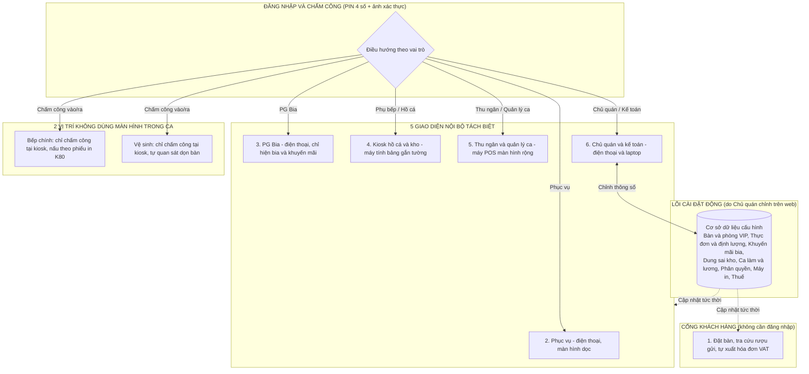

# KẾ HOẠCH CHI TIẾT XÂY DỰNG WEBSITE QUÁN NHẬU THEO ROLE
## Giao diện chuyên nghiệp, dashboard riêng từng vị trí, chấm công - tính lương và cài đặt động không cần sửa code

> [!IMPORTANT]
> **3 nguyên tắc cốt lõi của website**
> 1. **Mỗi vị trí một giao diện riêng, không rối:** 1 role = 1 màn hình chuyên biệt + 1 bảng số liệu riêng + 1 thẻ lương tạm tính. Đăng nhập bằng mã PIN 4 số là vào thẳng màn hình của mình, các chức năng không liên quan bị ẩn hoàn toàn.
> 2. **Chủ quán tự cài đặt mọi thông số trên web:** bàn, khu vực, thực đơn, định lượng, khuyến mãi, dung sai kho, ca làm, luật chấm công, công thức lương, phân quyền, máy in, thuế suất. Không thông số nào bị viết cứng trong code.
> 3. **Giao diện chuyên nghiệp như sản phẩm thương mại:** không dùng emoji ở bất kỳ đâu trên web. Toàn bộ biểu tượng dùng một bộ icon SVG nét mảnh thống nhất, luôn đi kèm chữ. Bố cục sạch, nhiều khoảng trắng, chữ dễ đọc, thao tác sắp xếp đúng trình tự công việc thực tế.

---

## 1. TỔNG QUAN: 7 VỊ TRÍ, 6 GIAO DIỆN ĐỘC LẬP VÀ LÕI CÀI ĐẶT ĐỘNG



### Ma trận "Ai thấy gì - Ai bị ẩn gì"

| STT | Vai trò | Thiết bị | Thấy trên màn hình | Bị ẩn hoàn toàn |
| :--- | :--- | :--- | :--- | :--- |
| 1 | Khách hàng | Điện thoại cá nhân | Đặt bàn, đặt cọc VietQR, tra cứu rượu gửi, tự xuất hóa đơn VAT | Toàn bộ nghiệp vụ nội bộ |
| 2 | Phục vụ | Điện thoại (dọc) | Sơ đồ bàn mình phụ trách, gọi món, yêu cầu tạm tính, chấm công, lương và tiền tip của mình | Giá vốn, tồn kho, sửa/xóa bill đã in, doanh thu quán, lương người khác, cài đặt |
| 3 | PG Bia | Điện thoại (dọc) | Danh mục bia/nước, quỹ khuyến mãi hãng, thu nắp/vỏ két, chấm công, hoa hồng | Món bếp, hải sản cân ký, thanh toán |
| 4 | Phụ bếp / Hồ cá | Máy tính bảng gắn tường | Hàng đợi cân hải sản, tồn bể (con/kg), báo hao hụt, nhập kho, kiểm kho, chấm công khối bếp | Giá bán, tiền mặt, danh sách bia |
| 5 | Thu ngân / QL ca | Máy POS màn hình rộng | Sơ đồ bàn, bill, tạm tính, thanh toán, tách bill, chi vặt, chi ứng lương, chốt ca | Cấu hình kế toán, giá vốn, tự mở khóa bill khi chưa được duyệt |
| 6 | Chủ quán / Kế toán | Điện thoại và laptop | Tổng quan lãi lỗ, phê duyệt, kho, nhân sự - lương, thuế, cài đặt | Màn hình gọi món chi tiết của phục vụ |
| 7 | Bếp chính và Vệ sinh | Chỉ chạm kiosk khi vào/ra ca | Chấm công và xem lương tạm tính | Không dùng màn hình trong giờ làm |

---

## 2. HỆ THỐNG THIẾT KẾ GIAO DIỆN (DESIGN SYSTEM)

Toàn bộ 6 giao diện dùng chung **một** hệ thống thiết kế để nhìn đồng bộ và chuyên nghiệp. Mỗi vai trò chỉ khác nhau ở **nhãn vai trò nhỏ trên thanh tiêu đề**, không đổi cả bảng màu theo từng role (tránh cảm giác "cầu vồng", thiếu chuyên nghiệp).

### 2.1. Quy tắc biểu tượng - không dùng emoji

| Quy tắc | Chi tiết |
| :--- | :--- |
| Không emoji | Cấm tuyệt đối emoji trong giao diện, thông báo, phiếu in, tên món, tên nút. Có bước kiểm tra tự động trong quy trình build để chặn ký tự emoji lọt vào mã nguồn. |
| Một bộ icon duy nhất | Dùng bộ icon SVG nét mảnh (Lucide), độ dày nét 1.75px, kích thước 16 / 20 / 24px tùy thiết bị. Không trộn nhiều bộ icon. |
| Icon luôn có chữ đi kèm | Nút chính luôn là chữ (có thể kèm icon bên trái). Icon đứng một mình chỉ dùng cho thao tác phổ biến (đóng, tìm kiếm, quay lại) và luôn có chú thích khi rê chuột. |
| Phiếu in K80 | Chỉ dùng chữ, đường kẻ và mã QR. Không icon, không ký tự đặc biệt để máy in nhiệt in chuẩn. |

**Bảng quy đổi chức năng sang icon (thay cho emoji ở bản kế hoạch trước):**

| Chức năng | Icon | Chức năng | Icon |
| :--- | :--- | :--- | :--- |
| Sơ đồ bàn | `layout-grid` | Khóa bill / đã khóa sổ | `lock` |
| Gọi món | `clipboard-list` | Mở khóa (cần duyệt) | `lock-open` |
| Hải sản / hồ cá | `fish` | Cân điện tử | `scale` |
| Bia / đồ uống | `beer` | Kho / nhập hàng | `package` |
| Máy in | `printer` | Tiền mặt | `banknote` |
| VietQR / chuyển khoản | `qr-code` | Chấm công | `clock` |
| Lương / ứng lương | `wallet` | Phê duyệt | `circle-check` |
| Cảnh báo | `triangle-alert` | Thuế / hóa đơn | `receipt-text` |
| Nhân sự | `users` | Cài đặt | `settings` |
| Báo cáo / lãi lỗ | `chart-line` | Đặt bàn | `calendar-clock` |

### 2.2. Màu sắc

Nền trung tính, một màu chủ đạo cho thao tác, các màu còn lại chỉ dùng để báo trạng thái.

| Vai trò màu | Mã màu | Dùng cho |
| :--- | :--- | :--- |
| Nền trang | `#F7F8FA` | Nền chung |
| Bề mặt thẻ | `#FFFFFF` | Thẻ, bảng, hộp thoại |
| Viền | `#E4E7EC` | Đường chia, viền ô nhập |
| Chữ chính | `#101828` | Tiêu đề, số liệu |
| Chữ phụ | `#667085` | Chú thích, nhãn |
| Màu chủ đạo | `#1F4FD8` | Nút chính, liên kết, mục đang chọn |
| Thành công | `#12805C` | Đã thanh toán, đã duyệt, đúng giờ |
| Cảnh báo | `#B54708` | Sắp hết giờ, gần chạm ngưỡng |
| Nguy hiểm | `#C01048` | Lỗi, lệch kho, hủy, từ chối |
| Thông tin | `#0E7090` | Gợi ý, trạng thái trung tính |

**Màu trạng thái bàn** (luôn kèm chữ và icon, không chỉ dựa vào màu để người mù màu vẫn phân biệt được):

| Trạng thái | Nền ô bàn | Nhãn hiển thị |
| :--- | :--- | :--- |
| Trống | Trắng, viền xám | `Trống` |
| Đặt trước | Tím nhạt | `Đặt 19:00` |
| Đang phục vụ | Xanh dương nhạt | `42 phút · 1.250.000` |
| Chờ cân hải sản | Cam nhạt | `Chờ cân` |
| Đã in tạm tính | Đỏ nhạt + icon khóa | `Đã khóa · chờ thu` |
| Cần dọn | Vàng nhạt | `Cần dọn` |

**Chế độ tối:** POS và kiosk có tùy chọn giao diện tối dùng ban đêm (Chủ quán bật trong Cài đặt), giảm chói khi quán tắt bớt đèn.

### 2.3. Chữ và định dạng số

* **Font:** `Be Vietnam Pro` (thiết kế riêng cho tiếng Việt, dấu rõ, không dính dòng). Dự phòng: `Inter`, hệ thống.
* **Cỡ chữ:**

| Cấp | Desktop | Mobile | Kiosk | Dùng cho |
| :--- | :--- | :--- | :--- | :--- |
| Số liệu lớn | 28px | 24px | 64-96px | Số trên thẻ dashboard, số kg trên cân |
| Tiêu đề trang | 20px | 18px | 28px | Tên màn hình |
| Tiêu đề khối | 16px | 16px | 22px | Tên thẻ, tên nhóm |
| Nội dung | 14px | 15px | 20px | Danh sách, bảng |
| Chú thích | 12px | 13px | 16px | Nhãn phụ, thời gian |

* **Số liệu:** dùng chữ số đều độ rộng (tabular) để cột số thẳng hàng; tiền căn phải.
* **Định dạng chuẩn Việt Nam:** tiền `1.250.000 đ`, khối lượng `1,25 kg`, giờ `21:45`, ngày `04/11/2026`. Không viết tắt khó hiểu.

### 2.4. Khoảng cách, bo góc, kích thước chạm

* Lưới khoảng cách bội số 8px (4 / 8 / 16 / 24 / 32).
* Bo góc 8px cho thẻ và nút, 12px cho hộp thoại. Bóng đổ rất nhẹ, chỉ dùng cho phần nổi (hộp thoại, menu).

| Thiết bị | Chiều cao nút tối thiểu | Khoảng cách giữa 2 nút |
| :--- | :--- | :--- |
| Desktop POS / Chủ quán | 40px (nút chính 48px) | 8px |
| Điện thoại | 48px | 8px |
| Kiosk hồ cá / kho | 80px | 16px (tránh chạm nhầm khi tay ướt) |

### 2.5. Thư viện thành phần dùng chung

Thanh tiêu đề (tên quán, nhãn vai trò, trạng thái ca, tên người dùng), thẻ số liệu (KPI card), ô bàn, dòng món, thanh giỏ hàng, bàn phím số, hộp thoại xác nhận, thông báo nổi có nút Hoàn tác, banner mất kết nối, bảng dữ liệu có lọc, thẻ phê duyệt, trình chỉnh sửa cài đặt, khung xem trước phiếu in. Tất cả thành phần dùng lại ở mọi giao diện để học một lần là dùng được khắp nơi.

---

## 3. 11 NGUYÊN TẮC SẮP XẾP THAO TÁC

| # | Nguyên tắc | Áp dụng cụ thể |
| :--- | :--- | :--- |
| 1 | **Việc làm nhiều nhất đặt ở chỗ dễ chạm nhất** | Điện thoại: 1/3 dưới màn hình (vùng ngón cái). POS: cột phải + phím tắt. Kiosk: chính giữa màn hình. |
| 2 | **Đi đúng trình tự công việc thực tế** | Bố cục từ trái sang phải, trên xuống dưới theo thứ tự: chọn bàn → chọn món → xác nhận → gửi. Mỗi thao tác chính tối đa 3 bước. |
| 3 | **Mỗi màn hình chỉ một nút chính** | Nút chính tô màu đậm. Nút phụ dạng viền. Nút hủy/xóa màu đỏ, đặt tách xa nút chính. |
| 4 | **Điền sẵn giá trị mặc định thông minh** | Số lượng mặc định 1, kiểu chế biến phổ biến nhất của món được chọn sẵn, bàn đang mở được chọn sẵn, phương thức thanh toán gần nhất. |
| 5 | **Hoàn tác thay vì hỏi lại** | Thao tác đảo ngược được (thêm nhầm món chưa gửi) → thông báo nổi có nút Hoàn tác trong 5 giây. Thao tác không đảo ngược được (hủy món đã in, mở khóa bill, chốt ca) → hộp xác nhận nêu rõ hậu quả và bắt buộc nhập lý do. |
| 6 | **Phản hồi ngay lập tức** | Mọi lần chạm có phản hồi trong 0,1 giây. Mỗi đơn hiển thị rõ trạng thái: Đang gửi → Đã gửi bếp → Đã in. Mất mạng → banner "Đang mất kết nối, đơn sẽ tự gửi lại khi có mạng". |
| 7 | **Trạng thái không chỉ bằng màu** | Luôn có màu + chữ + icon. |
| 8 | **Thông báo đúng mức độ** | Chỉ chặn màn hình khi bắt buộc phải xử lý. Còn lại dùng huy hiệu số, banner hoặc thông báo nổi tự tắt. |
| 9 | **Hạn chế gõ phím** | Dùng nút chọn nhanh, bàn phím số lớn, quét QR. Ô tìm kiếm hiểu không dấu: gõ "ca chem" ra "Cá chẽm", gõ "bo" ra "Bò lúc lắc". |
| 10 | **Vị trí cố định, nhất quán** | Một chức năng luôn nằm ở một chỗ trên mọi màn hình. Không tự đổi chỗ nút theo ngữ cảnh. |
| 11 | **Dashboard: việc cần làm trước, số liệu tham khảo sau** | Tối đa 4-5 thẻ số liệu. Mỗi thẻ: con số lớn + so sánh nhỏ (so với hôm qua / chỉ tiêu) + chạm để xem chi tiết. Thẻ cần hành động xếp đầu tiên. |

---

## 4. BỐ CỤC VÀ LUỒNG THAO TÁC CHI TIẾT TỪNG GIAO DIỆN

### 4.1. Giao diện 1 - Website khách hàng

**Bố cục:** một cột, tối ưu điện thoại. Thanh trên có 3 mục: `Đặt bàn` | `Rượu gửi` | `Xuất hóa đơn`.

**Luồng đặt bàn - 3 bước có thanh tiến trình:**
1. **Thời gian và số người:** chọn ngày, giờ (nút chọn nhanh theo khung giờ còn trống), số người.
2. **Khu vực:** Sân vườn / Trong nhà / Phòng VIP. Mỗi lựa chọn hiện ảnh thật, sức chứa, phụ thu (nếu có). Khu vực hết chỗ hiển thị mờ kèm chữ "Hết chỗ khung giờ này".
3. **Thông tin và đặt cọc:** tên, số điện thoại, ghi chú. Nếu quán yêu cầu cọc → hiện mã VietQR kèm đồng hồ đếm ngược giữ chỗ (số phút do Chủ quán cài đặt). Thanh toán xong tự chuyển sang màn hình xác nhận kèm mã đặt bàn.

**Rượu gửi:** nhập số điện thoại → nhận mã OTP → danh sách chai đang gửi (tên rượu, phần còn lại %, hạn lưu giữ).

**Xuất hóa đơn:** quét QR cuối bill → nhập mã số thuế → hệ thống tự điền tên và địa chỉ công ty → nhập email → bấm `Gửi yêu cầu xuất hóa đơn`.

---

### 4.2. Giao diện 2 - Phục vụ (điện thoại, màn hình dọc)

**Thay đổi so với bản trước:** bỏ tab "Gọi món" độc lập. Gọi món luôn bắt đầu từ việc chạm vào bàn, nhờ vậy **không bao giờ gọi nhầm bàn**. Ba tab đáy mới:

| Tab | Nội dung |
| :--- | :--- |
| `Bàn` (mặc định) | Sơ đồ bàn mình phụ trách, thanh số liệu thu gọn phía trên |
| `Việc cần làm` (có huy hiệu số) | Món đã ra cần bưng, hải sản đã cân xong, bàn gọi thêm, phòng VIP sắp hết giờ |
| `Cá nhân` | Chấm công, lương tạm tính, tiền tip, xin ứng lương |

```text
┌──────────────────────────────────┐
│ Quán Nhậu ABC        [Phục vụ]   │  Thanh tiêu đề
│ Lan · Đang trong ca từ 15:56     │
├──────────────────────────────────┤
│ Bàn đang mở   Chờ cân   Tip hôm nay│  Thanh số liệu (vuốt ngang,
│     4            1       120.000 │  chạm để thu gọn)
├──────────────────────────────────┤
│ [Tất cả] [Sân vườn] [Trong nhà]  │  Lọc khu vực
│                                  │
│ ┌──────┐ ┌──────┐ ┌──────┐       │
│ │ A01  │ │ A02  │ │ A03  │       │  Ô bàn: số bàn + trạng thái
│ │Trống │ │42 ph │ │Chờ   │       │  bằng chữ + màu
│ └──────┘ └──────┘ │ cân  │       │
│                   └──────┘       │
├──────────────────────────────────┤
│   Bàn    │ Việc cần làm (3) │ Cá nhân │  Tab đáy (vùng ngón cái)
└──────────────────────────────────┘
```

**Luồng gọi món (tối đa 3 chạm cho món thường):**
1. Chạm ô bàn → mở **màn hình chi tiết bàn**: danh sách món đã gọi (kèm trạng thái Đã gửi / Đã ra), tổng tạm tính, nút chính `Thêm món` ở đáy.
2. Chạm `Thêm món` → danh mục dạng nút ngang (`Món nhanh` | `Nướng - Lẩu` | `Hải sản` | `Bia - Nước`) + ô tìm kiếm không dấu. **Chạm vào món = thêm 1 phần**; chạm lần nữa = thêm phần; nhấn giữ = chọn kiểu chế biến và ghi chú.
3. Thanh giỏ cố định dưới đáy hiện `Gửi bếp · 5 món` → chạm để gửi. Có thông báo nổi "Đã gửi bếp" kèm Hoàn tác trong 5 giây, sau đó tự quay về sơ đồ bàn.

**Luồng hải sản cân ký:** chọn loại hải sản → chọn kiểu chế biến → ước lượng số con → `Gửi yêu cầu cân`. Ô bàn chuyển trạng thái `Chờ cân`. Khi kiosk cân xong, số kg và thành tiền tự cập nhật vào bill, tab `Việc cần làm` báo "Bàn A03: Cá mú 1,25 kg đã cân".

**Các thao tác khác trong màn hình chi tiết bàn** (xếp theo tần suất, nằm trong nút `Thao tác khác`): `Yêu cầu in tạm tính`, `Tạo thẻ rượu gửi`, `Chuyển bàn`, `Ghép bàn`.

**Tab Cá nhân - thứ tự hiển thị:**
1. Thẻ chấm công: trạng thái ca, giờ vào, số giờ đã làm, nút `Chấm công ra ca`.
2. Thẻ lương tạm tính tháng này: con số thực lĩnh lũy kế, chạm để xem chi tiết (Giờ công + Thưởng + Tip - Đi trễ - Đã ứng).
3. Nút phụ `Xin ứng lương` (hiển thị hạn mức còn được ứng).

---

### 4.3. Giao diện 3 - PG Bia (điện thoại, màn hình dọc)

**Ba tab đáy:** `Bàn` | `Quỹ khuyến mãi` | `Cá nhân`.

**Luồng bán bia (2 chạm):**
1. Chạm ô bàn → lưới sản phẩm cỡ lớn chỉ gồm bia, nước ngọt, đá của các hãng PG phụ trách.
2. Mỗi sản phẩm có 2 nút: `+1 lon` và `+1 thùng` (quy đổi theo cài đặt, ví dụ 24 lon). Hệ thống tự áp khuyến mãi theo luật Chủ quán cài, hiển thị dòng "Tặng 2 lon - trừ quỹ hãng". Bấm `Gửi` ở thanh đáy.

**Thanh số liệu đầu tab Bàn:** Sản lượng ca / chỉ tiêu (thanh tiến độ) · Quỹ khuyến mãi còn lại · Nắp và vỏ két cần thu hồi.

**Tab Quỹ khuyến mãi:** số lon tặng đã dùng theo từng bàn; cuối ca có biểu mẫu `Nộp nắp và vỏ két` (nhập số lượng bằng bàn phím số, hệ thống so với số lý thuyết và báo lệch).

**Tab Cá nhân:** giống phục vụ, thay thưởng bán hàng bằng hoa hồng sản lượng.

---

### 4.4. Giao diện 4 - Kiosk hồ cá, kho bếp và trạm chấm công (máy tính bảng ngang)

**Màn hình mặc định là hàng đợi cân** vì đây là việc làm nhiều nhất trong giờ cao điểm.

```text
┌───────────────────────────────────────────────────────────────────┐
│ [Cân hải sản]  [Báo hao hụt]  [Nhập / Kiểm kho]        [Chấm công] │  4 nút lớn 80px
├──────────────────────────┬────────────────────────────────────────┤
│ HÀNG ĐỢI CÂN (3)         │  Bàn A03 · Cá mú · Hấp Hồng Kông        │
│                          │                                        │
│ ▌A03 Cá mú      02:15    │              1,25 kg                   │  Số kg từ cân
│  B07 Tôm hùm    00:48    │                                        │  cỡ chữ 96px
│  VIP1 Cua thịt  00:10    │      Số con:   [ - ]   2   [ + ]       │
│                          │                                        │
│ (xếp theo chờ lâu nhất,  │  ┌──────────────────────────────────┐  │
│  quá 3 phút chuyển đỏ)   │  │     XÁC NHẬN VÀ IN TEM           │  │  Nút chính
│                          │  └──────────────────────────────────┘  │  cao 80px
├──────────────────────────┴────────────────────────────────────────┤
│ Tồn bể: Cá mú 14 con / 18,2 kg · Tôm hùm 6 con / 4,1 kg  ...      │  Dải tồn bể
└───────────────────────────────────────────────────────────────────┘
```

**Luồng cân (2 chạm):** chạm lệnh trong hàng đợi (lệnh cũ nhất được chọn sẵn) → đặt hải sản lên cân, số kg tự nhảy → kiểm tra số con → `Xác nhận và in tem`. In 2 tem: 1 tem buộc vào hải sản, 1 tem kẹp phiếu bếp.

**Báo hao hụt:** chọn mặt hàng → nhập số con và số kg → chụp ảnh bằng chứng (bắt buộc) → `Gửi chủ quán duyệt`.

**Nhập / Kiểm kho:**
* *Nhập kho sáng:* danh sách hàng theo phiếu đặt, nhập số thực nhận, 2 người cùng nhập PIN xác nhận.
* *Kiểm kho cuối ca:* **ẩn hoàn toàn số tồn lý thuyết**, nhân viên chỉ nhập số đếm thực tế. Bấm `Nộp kết quả kiểm kho` là khóa, không sửa được.

**Chấm công:** nút luôn ở góc phải trên. Sau 60 giây không thao tác, kiosk chuyển sang màn hình chờ hiển thị đồng hồ lớn và dòng chữ "Chạm để chấm công" — bếp chính và vệ sinh chỉ cần chạm, nhập PIN 4 số, camera tự chụp 1 giây, màn hình hiện "Đã chấm công vào ca lúc 15:58" kèm lương tạm tính, sau 3 giây tự đóng.

---

### 4.5. Giao diện 5 - POS thu ngân và quản lý ca (desktop, chia 2 cột cố định)

```text
┌──────────────────────────────────────────────────────────────────────────────┐
│ Quán Nhậu ABC [Thu ngân]  Tiền mặt trong két 4.350.000 · VietQR 12.800.000 ·  │ Thanh số liệu
│ Bàn chờ thu 3 · Nhân sự trong ca 11 · Máy in: Bình thường                     │ 1 dòng
├───────────────────────────────────────────────┬──────────────────────────────┤
│ [Tất cả] [Sân vườn] [Trong nhà] [VIP]          │ Bàn A02 · 6 khách · 42 phút  │
│ [Đang phục vụ] [Chờ thu] [Đặt trước]           │ Phục vụ: Lan                 │
│                                               ├──────────────────────────────┤
│  ┌─────┐ ┌─────┐ ┌─────┐ ┌─────┐ ┌─────┐      │ Bò lúc lắc        2  360.000 │
│  │ A01 │ │ A02 │ │ A03 │ │ A04 │ │ A05 │      │ Cá mú hấp 1,25kg     812.500 │
│  └─────┘ └─────┘ └─────┘ └─────┘ └─────┘      │ Bia Tiger thùng   1  420.000 │
│                                               │ ...                          │
│  VIP1  Còn 25 phút · Đã chi 2.400.000 /        ├──────────────────────────────┤
│        tối thiểu 3.000.000                    │ Tạm tính           1.592.500 │
│                                               │ VAT                  135.400 │
│                                               │ TỔNG CỘNG          1.727.900 │
│           60% chiều rộng                      ├──────────────────────────────┤
│                                               │ [In tạm tính  F2]            │
│                                               │ [   THANH TOÁN   F9   ]      │ Nút chính
│                                               │ [Tách bill] [Chuyển bàn]     │
│                                               │ [Thao tác khác ▾]            │
└───────────────────────────────────────────────┴──────────────────────────────┘
```

**Thứ tự nút ở cột phải đúng theo trình tự thực tế:** `In tạm tính` → `Thanh toán` (nút chính, lớn nhất) → `Tách bill`, `Chuyển bàn` → `Thao tác khác` (Giảm giá theo quyền, Chi vặt, Chi ứng lương, Mở két). Sau khi in tạm tính, bill khóa và hiện dòng `Đã khóa lúc 22:41 · Yêu cầu mở khóa` (gửi chủ quán duyệt).

**Hộp thoại thanh toán:**
* Số tiền cần thu hiển thị cỡ lớn.
* 3 phương thức dạng tab: `Tiền mặt` | `VietQR` | `Kết hợp`.
* Tiền mặt: nút mệnh giá nhanh (`Đủ tiền`, `500.000`, `1.000.000`, `2.000.000`) + bàn phím số; tiền thối hiện chữ lớn màu xanh.
* VietQR: mã QR động hiện trên màn hình phụ hướng về khách; khi ngân hàng báo đã nhận, hộp thoại tự đóng và in hóa đơn. Nếu khách chuyển dư, hiện lựa chọn `Ghi nhận là tiền tip cho phục vụ`.

**Chốt ca - trình hướng dẫn 3 bước:** (1) Đếm tiền theo từng mệnh giá → (2) Hệ thống so với số phải có và hiện chênh lệch → (3) Nhập giải trình nếu lệch, `Xác nhận và in báo cáo chốt ca`. Sau giờ khóa sổ do Chủ quán cài, ca tự khóa.

**Phím tắt:**

| Phím | Chức năng | Phím | Chức năng |
| :--- | :--- | :--- | :--- |
| `F1` | Tìm bàn | `F6` | Chuyển bàn |
| `F2` | In tạm tính | `F7` | Chi vặt |
| `F3` | Tìm món thêm nhanh | `F8` | Chốt ca |
| `F4` | Tách bill | `F9` | Thanh toán |
| `Esc` | Đóng hộp thoại | `Enter` | Xác nhận |

---

### 4.6. Giao diện 6 - Chủ quán và kế toán

**Thanh điều hướng bên trái** (trên điện thoại chuyển thành 5 mục ở đáy + mục "Thêm"), xếp theo tần suất sử dụng:

1. `Tổng quan`
2. `Phê duyệt` (huy hiệu số việc chờ)
3. `Bán hàng và lãi lỗ`
4. `Kho và đối soát`
5. `Nhân sự và lương`
6. `Thuế và hóa đơn`
7. `Cài đặt`

```text
┌──────────────┬───────────────────────────────────────────────────────────────┐
│ Quán Nhậu ABC│ Tổng quan · Hôm nay 04/11/2026                 [Hôm nay ▾]    │
│              ├───────────────┬───────────────┬───────────────┬───────────────┤
│ Tổng quan    │ Doanh thu     │ Lãi gộp ước   │ Chờ duyệt     │ Cảnh báo      │
│ Phê duyệt  4 │ 38.450.000    │ 15.200.000    │ 4 việc        │ 2             │
│ Bán hàng     │ +12% hôm qua  │ Biên 39,5%    │ Xem ngay      │ Lệch kho 1    │
│ Kho          ├───────────────┴───────────────┼───────────────┴───────────────┤
│ Nhân sự-Lương│ VIỆC CẦN DUYỆT                │ CẢNH BÁO BẤT THƯỜNG           │
│ Thuế-Hóa đơn │ Mở khóa bill A02 · Thu ngân   │ Biên lãi cá mú 31% (< 35%)    │
│              │ Lý do: khách đổi món          │ Kiểm kho: tôm hùm lệch 1 con  │
│ Cài đặt      │        [Từ chối] [Duyệt]      │                               │
│              │ Báo hao hụt cá chẽm 0,8 kg    │                               │
│              │ [ảnh] [Từ chối] [Duyệt]       │                               │
│              ├───────────────────────────────┴───────────────────────────────┤
│              │ Doanh thu theo giờ (biểu đồ cột)                               │
└──────────────┴───────────────────────────────────────────────────────────────┘
```

**Thẻ phê duyệt chuẩn:** tiêu đề việc, người đề nghị, thời gian, số tiền ảnh hưởng, ảnh bằng chứng (nếu có), lý do; hai nút `Từ chối` (phải nhập lý do) và `Duyệt`. Các việc rủi ro thấp (ví dụ hao hụt dưới ngưỡng tiền Chủ quán đặt) cho phép chọn nhiều và `Duyệt tất cả`.

**Các trang còn lại:** mỗi trang có bộ lọc thời gian thống nhất ở góc phải trên (Hôm nay / Tuần này / Tháng này / Tùy chọn), bảng dữ liệu có thể xuất Excel, và luôn có một dòng tóm tắt bằng chữ ở đầu trang (ví dụ "Tháng 11: chi phí nhân sự chiếm 22% doanh thu, thấp hơn tháng trước 1,5%").

---

### 4.7. Trang Cài đặt - trải nghiệm chỉnh sửa an toàn, dễ hiểu

```text
┌────────────────────┬─────────────────────────────────────────────────────────┐
│ [Tìm cài đặt...]   │ Ca làm và lương                                          │
│                    │ ┌─────────────────────────────────────────────────────┐  │
│ Bàn và đặt chỗ     │ │ Thời gian dọn dẹp sau bàn cuối                       │  │
│ Thực đơn - định lượng│ │ Giờ công được tính tối đa đến giờ đóng bill cuối   │  │
│ Khuyến mãi bia     │ │ cộng thêm số phút này.                               │  │
│ Kho và khóa sổ     │ │ [   30   ] phút        Mặc định: 30 phút             │  │
│ Ca làm và lương  ● │ └─────────────────────────────────────────────────────┘  │
│ Nhân viên - quyền  │ ┌─────────────────────────────────────────────────────┐  │
│ Máy in - mẫu bill  │ │ Hệ số lương tăng ca đêm   [ 1,3 ]                    │  │
│ Thuế - kế toán     │ └─────────────────────────────────────────────────────┘  │
│                    ├─────────────────────────────────────────────────────────┤
│ Lịch sử thay đổi   │ Có 2 thay đổi chưa lưu          [Hủy bỏ] [Lưu và áp dụng]│ Thanh lưu cố định
└────────────────────┴─────────────────────────────────────────────────────────┘
```

* **Mỗi ô cài đặt có:** tên dễ hiểu, một câu giải thích tác dụng, đơn vị đi kèm (phút, %, đồng), giá trị mặc định để đối chiếu.
* **Thanh lưu cố định ở đáy** chỉ xuất hiện khi có thay đổi, đếm số thay đổi chưa lưu. Rời trang khi chưa lưu sẽ được nhắc.
* **Hộp xác nhận khi lưu** liệt kê "Giá trị cũ → Giá trị mới" và cho chọn thời điểm áp dụng: `Ngay bây giờ` / `Từ ca tiếp theo` / `Từ ngày...` (dùng cho thay đổi giá, thuế suất, công thức lương để không ảnh hưởng ca đang chạy).
* **Kiểm tra hợp lệ ngay khi nhập:** ví dụ thuế suất chỉ nhận 0-10%, bán kính GPS 10-500m, hạn mức ứng lương 0-100%; báo lỗi ngay dưới ô bằng chữ đỏ, nêu rõ cách sửa.
* **Xem trước trực tiếp:** mẫu bill hiển thị bản xem trước khổ K80 bên cạnh; sơ đồ bàn chỉnh bằng kéo - thả.
* **Lịch sử thay đổi:** ghi lại ai đổi gì, lúc nào, giá trị cũ - mới; có nút `Khôi phục` về phiên bản trước.

---

## 5. NGÔN NGỮ HIỂN THỊ TRÊN GIAO DIỆN

Thuật ngữ kỹ thuật trong tài liệu phân tích được **đổi sang tiếng Việt thông dụng** khi hiển thị cho người dùng:

| Thuật ngữ trong tài liệu | Chữ hiển thị trên web |
| :--- | :--- |
| Pre-Bill / Auto Pre-Bill Lock | Phiếu tạm tính / Khóa bill sau khi in tạm tính |
| Z-Report / Auto Shift Z-Lock | Báo cáo chốt ca / Tự khóa ca lúc ... |
| Blind Inventory Count | Kiểm kho cuối ca |
| Live Payslip | Lương tạm tính |
| Bottle Keep | Rượu gửi |
| Approval Inbox | Phê duyệt |
| Up-sell Commission | Thưởng bán hàng |
| Minimum Spend | Mức chi tối thiểu |
| No-show | Khách không đến |
| Auto Overtime Cap | Giới hạn giờ công sau bàn cuối |
| Dashboard | Tổng quan |
| No-Code Settings Studio | Cài đặt |
| Wastage | Hao hụt |
| Supplier Rebate | Thưởng sản lượng hãng |

**Quy tắc viết chữ:**
* Nút bấm bắt đầu bằng động từ, nói rõ kết quả: `Gửi bếp`, `In tạm tính`, `Xác nhận và in tem`, không dùng `OK`, `Submit`.
* Thông báo lỗi gồm 2 phần: *chuyện gì xảy ra* + *cần làm gì*. Ví dụ: "Máy in bếp nướng không phản hồi. Kiểm tra giấy in hoặc chuyển sang máy in dự phòng."
* Màn hình trống luôn có hướng dẫn: "Chưa có bàn nào đang mở. Chạm vào một bàn trống để bắt đầu."
* Không viết hoa toàn bộ câu dài (chỉ dùng cho nhãn ngắn), không dùng dấu chấm than.

---

## 6. NỘI DUNG 8 NHÓM CÀI ĐẶT (CHỦ QUÁN TỰ CHỈNH TRÊN WEB)

Khi Chủ quán bấm `Lưu và áp dụng`, toàn bộ 6 giao diện cập nhật tức thời (hoặc theo thời điểm áp dụng đã chọn).

### Nhóm 1 - Bàn và đặt chỗ
* Thêm / sửa / xóa khu vực và bàn tự do (kéo - thả trên sơ đồ), không giới hạn số lượng.
* Phòng VIP: phụ thu theo giờ (có thể đặt 0 đ), mức chi tối thiểu để miễn phụ thu (bật/tắt).
* Đặt chỗ: thời gian giữ bàn chờ đặt cọc (15 / 30 / 45 phút...), số tiền cọc mặc định, số phút trễ hẹn trước khi tính là khách không đến.

### Nhóm 2 - Thực đơn và định lượng
* Thêm / sửa / ẩn món. Loại món: Món bếp (theo đĩa) | Hải sản cân ký (đơn vị kép con + kg) | Bia - nước (quản lý két, nắp) | Combo.
* Danh sách kiểu chế biến kèm phụ thu (Hấp Hồng Kông, Nướng muối ớt, Cháy tỏi...).
* Định lượng nguyên liệu (mỗi đĩa trừ bao nhiêu túi định lượng, túi nặng bao nhiêu gam) và quy đổi đơn vị (1 thùng = 24 lon, 1 két = 20 chai).
* Ngưỡng cảnh báo biên lãi gộp tối thiểu (ví dụ 35%).

### Nhóm 3 - Khuyến mãi bia và thưởng hãng
* Tạo chương trình khuyến mãi: chọn hãng → kiểu (Mua X tặng Y) → nguồn trừ (Quỹ hãng / Chi phí quán) → bật/tắt yêu cầu thu hồi nắp, vỏ.
* Chỉ tiêu sản lượng tháng/quý từng hãng để theo dõi thưởng.

### Nhóm 4 - Kho và khóa sổ
* Dung sai từng kho: hồ hải sản (lệch số con mặc định 0, hao nước số kg 0-10%, mặc định 5%), bếp (lệch túi định lượng 3%), phụ phẩm đá - gas - than - gia vị (trần 4,5% doanh thu bếp).
* Các chốt khóa tự động (bật/tắt, chỉnh giờ): khóa bill khi in tạm tính (hoặc cho phép sửa trong X giây đầu), giờ tự khóa ca (00:30 / 01:30 / 03:00...), khóa kết quả kiểm kho, khóa kỳ thuế.

### Nhóm 5 - Ca làm và lương
* Tạo ca làm (ca sáng, ca chiều, ca gãy 4 mốc, ca đêm).
* Chấm công: tên Wi-Fi quán, bán kính GPS (hoặc tắt), số phút cho phép đi trễ, bậc tiền phạt đi trễ (hoặc tắt).
* Giới hạn giờ công sau bàn cuối (+30 / +45 / +60 phút), hệ số tăng ca đêm (1,2 / 1,3 / 1,5).
* Lương cơ bản theo tháng (chia 26 hoặc 30 công) hoặc theo giờ cho từng người; mức thưởng bán hàng (đồng/kg hoặc % doanh thu món); hạn mức ứng lương (% lương đã làm).

### Nhóm 6 - Nhân viên và phân quyền
* Thêm nhân viên, gán vai trò, đổi mã PIN, khóa tài khoản người đã nghỉ.
* Ma trận quyền chi tiết theo vai trò (ví dụ: quản lý ca được duyệt hao hụt dưới 100.000 đ; thu ngân được tách bill không cần duyệt).
* Bật/tắt từng thẻ số liệu trên tổng quan của mỗi vai trò.

### Nhóm 7 - Máy in và mẫu bill
* Thêm máy in (bếp nướng, bếp lẩu, hồ cá, quầy bar), chọn nhóm món in ra máy nào, số liên in, máy in dự phòng.
* Cấu hình cân điện tử.
* Mẫu bill: tên quán, địa chỉ, số điện thoại, Wi-Fi, lời cảm ơn, tài khoản ngân hàng nhận VietQR, có bản xem trước khổ K80.

### Nhóm 8 - Thuế và kế toán
* Thuế suất GTGT theo nhóm hàng (đồ ăn 8% / 10%, bia rượu 10%, thuế khoán hộ kinh doanh 4,5%), đổi được ngay khi luật thay đổi, có chọn ngày hiệu lực.
* Chế độ kế toán: Hộ kinh doanh (S1-HKD, S2-HKD, 01/CNKD) hoặc Công ty TNHH (xuất XML/Excel cho MISA, HTKK).

---

## 7. TIÊU CHÍ NGHIỆM THU GIAO DIỆN (ĐO ĐƯỢC)

| Tiêu chí | Mục tiêu |
| :--- | :--- |
| Gọi 1 món thường | Tối đa 3 chạm từ sơ đồ bàn |
| Cân và in tem hải sản | Tối đa 2 chạm, dưới 10 giây |
| Thanh toán tiền mặt | Dưới 5 giây sau khi khách đưa tiền |
| Chấm công tại kiosk | Dưới 5 giây |
| Nhân viên mới tự sử dụng được | Sau 15 phút hướng dẫn |
| Emoji trong giao diện và phiếu in | 0 (kiểm tra tự động khi build) |
| Độ tương phản chữ / nền | Đạt chuẩn WCAG AA (tối thiểu 4,5:1) |
| Trạng thái chỉ thể hiện bằng màu | 0 trường hợp, luôn có chữ đi kèm |
| Màn hình điện thoại nhỏ nhất hỗ trợ | Rộng 360px, không cuộn ngang |
| Thời gian phản hồi khi chạm | Dưới 0,1 giây (có phản hồi hiển thị) |

---

## 8. LỘ TRÌNH XÂY DỰNG (5 GIAI ĐOẠN)

1. **Giai đoạn 0 - Hệ thống thiết kế và thư viện thành phần:** bảng màu, font, bộ icon, nút, thẻ số liệu, ô bàn, hộp thoại, thông báo, bàn phím số, chế độ sáng/tối; trang mẫu để duyệt giao diện trước khi làm nghiệp vụ.
2. **Giai đoạn 1 - Lõi cài đặt động, đăng nhập PIN, chấm công và điều hướng theo vai trò:** kho cấu hình dùng chung (lưu bền, cập nhật tức thời), đăng nhập PIN + ảnh xác thực, thanh chuyển vai trò để demo.
3. **Giai đoạn 2 - Giao diện tuyến đầu:** Khách hàng, Phục vụ, PG Bia, Kiosk hồ cá (cân, in tem mô phỏng, báo hao hụt, kiểm kho, lương tạm tính).
4. **Giai đoạn 3 - POS thu ngân:** khóa bill sau tạm tính, VietQR động, tách bill, tách tiền tip, giờ phòng VIP, chi vặt, chi ứng lương, chốt ca.
5. **Giai đoạn 4 - Chủ quán và Cài đặt:** tổng quan, phê duyệt, đối soát kho, nhân sự - lương, thuế - hóa đơn và 8 nhóm cài đặt có lịch sử thay đổi.

---

> [!TIP]
> **Bước tiếp theo đề xuất:** làm trước **Giai đoạn 0** (trang mẫu hệ thống thiết kế + màn hình mẫu của Phục vụ và POS Thu ngân) để anh/chị duyệt cảm quan giao diện, sau đó mới làm toàn bộ nghiệp vụ. Bấm **Proceed** hoặc nhắn để bắt đầu.
